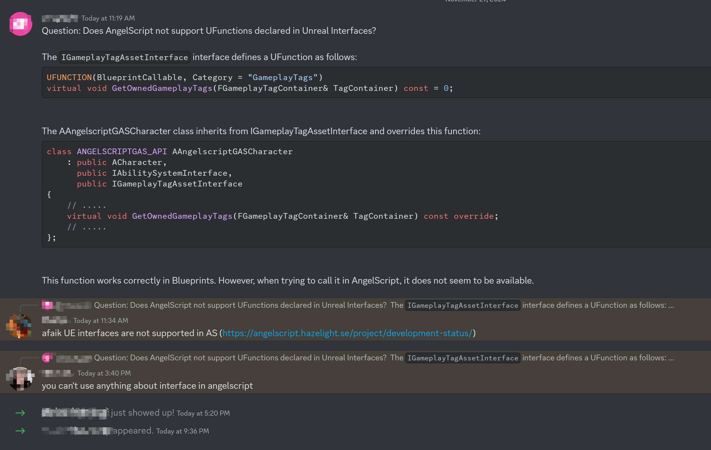

# UE_Angelscript — A remedy for missing Unreal Interfaces

# Where the problem comes from

One sentence: Hazelight does not officially support them.
Hazelight disables everything related to UE interfaces in its projects. They prefer Actor + Component composition, so Actor and ActorComponent support is more complete.

That gap is a headache for modules that use UE interfaces heavily. Other than editing the scripting plugin’s source, here are a few ways to ease the pain.

Note: manually binding the functions is another option beyond the methods below, but it is much more complicated and not covered in detail here.




# Calling Unreal Interface functions

One sentence: wrap them with cpp Mixins.

Calling a BlueprintCallable Unreal Interface function requires a wrapper. These functions are generally public, so a cpp Mixin can wrap them.

A `BP_` prefix is recommended; it is removed automatically when binding to AS, making the call look like a normal interface call. Personally, I like adding a suffix to remind me that it comes from an Unreal Interface and needs care.

Use ScriptCallable on the wrapper, otherwise Blueprints may end up with two identical functions.

If it is not much trouble, wrap the other functions without BlueprintCallable too, saving another binding pass later.

Someone suggested marking UFUNCTION again when inheriting the interface. That can work too. Once you inherit it, many things become easier.

# Overriding Unreal Interface functions

## Unreal Interface virtual functions

One sentence: inherit the class, then expose a BP\_ version specifically for Angelscript.

The same works for other functions you want Angelscript to override. Sometimes exposing a dynamic single-cast or multicast delegate handles the problem even more conveniently.

## BlueprintNativeEvent or BlueprintImplementableEvent

BlueprintNativeEvent is a bit like a virtual function, but more troublesome.

It often comes with BlueprintCallable. Bind the call through a Mixin as above. To override it, expose a BP\_ version in the implementation for Angelscript.

I have not found a way to override BlueprintImplementableEvent for now. Perhaps a function with the same name in the derived class would override it? This is rare, so I will set it aside.

Interfaces normally do not contain many of these. Some specifier conflicts may come from this rule: BlueprintCallable without BlueprintEvent and BlueprintCallable + BlueprintEvent cannot coexist in one Interface. The former needs NotBlueprintable on the UClass, while BlueprintEvent needs Blueprintable or no marker.

# Checking whether a class implements an Unreal Interface

We can check whether a Class implements an Unreal Interface, but cannot call an Object’s interface methods through an Unreal Interface pointer. Interfaces really get no love here.

Sometimes we still need to know whether a class implements an interface. There are a few ways.

1. The simplest is to inspect the inheritance chain.

2. Write a cpp function containing a Cast and expose it to scripts.

3. Use reflection, although the code is more complicated and may not perform well.

Here is a reflection-based example.

Make a cpp class such as UInterfaceAddonLibrary, derived from UBlueprintFunctionLibrary. Add two functions to check UClass and UObject interface implementation.

Also inject BP_HasInterface into UObject through UObjectMixinLibrary for convenient calls.

This reflection approach is fairly simple, but traversing ANY_PACKAGE may be slow. An optimized version is possible with more complicated logic. Write and test one if you need it.

```cpp
// ~~ InterfaceAddonLibrary.h
#pragma once

#include "Kismet/BlueprintFunctionLibrary.h"

#include "InterfaceAddonLibrary.generated.h"

UCLASS(MinimalAPI)
class UInterfaceAddonLibrary : public UBlueprintFunctionLibrary
{
    GENERATED_UCLASS_BODY()

public:
    /** Check if an UClass has Implemented an Unreal Interface by pass in an FName.
     * Example usage in Angelscript:     
     * \code     
     * Class ExampleActor : public AActor, public IExampleInterface     
     * InterfaceAddon::HasInterface_UClass(ExampleActor::StaticClass(),n"ExampleInterface");     
     * // Make the ExampleActor as ExampleActorObject     
     * InterfaceAddon::HasInterface_UClass(ExampleActorObject.Class,n"ExampleInterface");     
     * \endcode     
     **/
    UFUNCTION(BlueprintCallable)
    static bool HasInterface_UClass(UClass* ObjectClass, const FName& InterfaceName)
    {
       if (!ObjectClass || InterfaceName.IsNone())
       {
          UE_LOG(LogTemp, Warning, TEXT("Invalid input: ObjectClass or InterfaceName is null."));
          return false;
       }

       // Use FName to search the Interface class  (maybe it is not an Interface)
       const UClass* InterfaceClass = FindObject<UClass>(ANY_PACKAGE, *InterfaceName.ToString());
       if (!InterfaceClass)
       {
          UE_LOG(LogTemp, Warning, TEXT("Interface %s not found."), *InterfaceName.ToString());
          return false;
       }

       // Check if the Interface class found is exactly Interface
       if (!InterfaceClass->IsChildOf(UInterface::StaticClass()))
       {
          UE_LOG(LogTemp, Warning, TEXT("%s is not an interface class."), *InterfaceName.ToString());
          return false;
       }

       // check if the object class Implement the Interface
       if (ObjectClass->ImplementsInterface(InterfaceClass))
       {
          return true;
       }

       return false;
    }

     /** Check if an UObject has Implemented an Unreal Interface by pass in an FName.
     * Example usage in Angelscript:     
     * \code     
     * Class ExampleActor : public AActor, public IExampleInterface     
     * // Make the ExampleActor as ExampleActorObject     
     * InterfaceAddon::HasInterface(ExampleActorObject,n"ExampleInterface");      * \endcode     
     **/
    UFUNCTION(BlueprintCallable)
    static bool HasInterface(UObject* Object, const FName& InterfaceName)
    {
       if (!Object || InterfaceName.IsNone())
       {
          UE_LOG(LogTemp, Warning, TEXT("Invalid input: Object or InterfaceName is null."));
          return false;
       }

       return HasInterface_UClass(Object->GetClass(), InterfaceName);
    }
};

// ~~ InterfaceAddonLibrary.cpp
#pragma once

#include "InterfaceAddonLibrary.h"

UInterfaceAddonLibrary::UInterfaceAddonLibrary(
    const FObjectInitializer& ObjectInitializer)
    : Super(ObjectInitializer)
{
};
```

```cpp
// ~~ ObjectMixinLibrary.h
#pragma once

#include "CoreMinimal.h"
#include "InterfaceAddonLibrary.h"

#include "ObjectMixinLibrary.generated.h"

UCLASS(Meta = (ScriptMixin = "UObject"))
class DFMIXIN_API UObjectMixinLibrary : public UObject
{
    GENERATED_BODY()

public:
    /** Check if an UObject has Implemented an Unreal Interface by pass in an FName.
     * Example usage in Angelscript:     
     * \code     
     * Class ExampleActor : public AActor, public IExampleInterface     
     * // Make the ExampleActor as ExampleActorObject     
     * ExampleActorObject.HasInterface(n"ExampleInterface");     
     * \endcode     
     **/
    UFUNCTION(BlueprintPure, Category = "Unreal Interface", DisplayName="HasInterface")
    static bool BP_HasInterface(UObject* Object, const FName& InterfaceName)
    {
       return UInterfaceAddonLibrary::HasInterface(Object, InterfaceName);
    };
};
```
