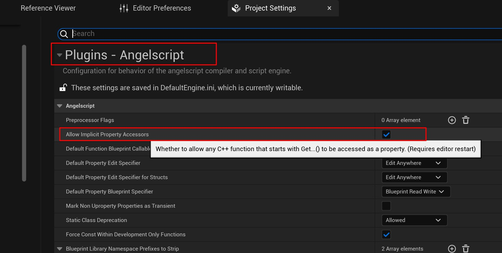

# UE_Angelscript — What a bound UClass looks like

This article mainly describes what a UClass declaration becomes after binding to AS.

Much of it is my own summary of the behavior I have seen from bound UClasses. For more precise definitions and internals, read the official documentation or the script binding source.

Something has to meet certain conditions before it can be bound, so let us start there.

# Which UClasses, UFunctions and UPROPERTY members does AS bind?

The official documentation says:
A `UCLASS()` with `BlueprintType`, or a `BlueprintCallable` member function, is bound.
Add `NotInAngelscript` to skip it.

There is an even simpler rule of thumb: if a Blueprint can access it, through its details panel or functions, AS binds it too.

There are a few exceptions, such as UE’s UInterface and special markers like `meta = (BlueprintInternalUseOnly = "true")`.
With that marker, AS cannot access the function. Ordinary Blueprint use cannot normally access it either.

```cpp
// this function cannot be accessed from AS
    UFUNCTION(BlueprintCallable, meta = (BlueprintInternalUseOnly = "true"))
    void TestBlueprintInternalUseOnly()
    {
       UE_LOG(LogTemp,Warning,TEXT("Test BlueprintInternalUseOnly UFUNCTION Show"));
    }
};
```

# What does it become, and how do we use it?

AS looks like cpp, but is not cpp. One important difference is that binding hides pointers.

UE-AS has no pointer concept; the official script implementation avoids it as far as possible.

But binding from cpp cannot make pointers disappear. Where did they go, and what do UClasses become?

After using them for a while, I think of these UClasses as **objects rather like Blueprint objects, whose validity can be checked**.

A Not Valid UClass object is in one of two states: empty, `nullptr`, or marked for collection but not yet collected.

## Null checks and IsValid

Since an object can be Not Valid, check its validity when using a UClass in AS.

C++ commonly uses a null-pointer check and sometimes `IsValid()`. Blueprints usually use `IsValid()`. AS supports both, but the syntax differs from cpp: there is no implicit null check. The underlying philosophy is to minimize implicit conversion.

Write a null check like this:

```cpp
UAbilitySystemComponent ASC = Cast<AbilitySystemComponent>(GetOuter());
if (ASC == nullptr)
{
	Error("Cannot get UAbilitySystemComponent!");
	return;
}
```

Yes, Blueprints cannot do this and do not need to. Cpp is concise because of implicit conversion.
Honestly, I still prefer cpp’s implicit pointer check, but the script maintainers stick to their principles.

Write IsValid like this:

```cpp
UAbilitySystemComponent ASC = Cast<AbilitySystemComponent>(GetOuter());
if (!IsValid(ASC))
{
	Error("Cannot get UAbilitySystemComponent!");
	return;
}
```

This IsValid is clearly a global function, unlike similarly named class methods. Keep that distinction in mind. Blueprints have a big advantage here: just drag out a wire.

The difference follows their meanings: Valid also considers GC markers.
Most of the time either check is fine.

## Using members and member functions

Using a class mostly means using its members and methods.

If a member is another class and may be invalid, check it for null or IsValid before use.

All member and function access uses `.`, never `->`.

Sometimes a member is accessible with `.`, yet also has a Get function. That is AS processing: a Get function makes property-style access available by default. Reading is one thing; writing is another. If the member is not exposed publicly — often why it has a Get function — and has no Set function, dot access can read it but cannot assign with `=`.
For example, suppose a cpp class exposes FloatValue to Blueprints but provides only a getter for IntValue:

```CPP
UClass()
class AExampleActorType : AActor
{
	// omitted
	int IntValue = 15;

	UPROPERTY(BlueprintReadWrite)
	float FloatValue = 6.0;

	UFUNCTION(BlueprintCallable)
	int GetIntValue()
	{
		return IntValue;
	}
};
```

Then these things happen in AS:

```cpp
class AExampleActor_AS : AActor
{
	UFUNCTION(BlueprintOverride)
    void BeginPlay()
    {
    // spawn an instance of the AExampleActorType class
    AExampleActorType Example = SpawnActor(AExampleActorType);
    // Example can read and write FloatValue freely
    Example.FloatValue = 8.0;
    // Example can read IntValue without writing GetIntValue(), though writing it also works.
    Print(f"{Example.IntValue}");
    // the next line reports an error because writing is not supported. If IntValue had a Set function, it would work.
    Example.IntValue = 3;
    }
}
```

An extension: AS methods starting with `Get..()` or `Set..()` can end their declaration with `property` and then be used like properties. These are Property Accessor Functions. Watch out: automatic binding adds this by default. It is convenient but can be confusing.

Simply put, dot syntax can read or write Get and Set method values as though they were actual members. This is syntax sugar.

So not everything near the top of autocomplete after `.` is a stored member. Some entries come from methods.

Here is the official documentation’s example:

```cpp
class AExampleActor : AActor
{
    // the property keyword makes the value of this member function be accessed like an ordinary member
    // This is written in AS, so the keyword has to be added; bindings in cpp add it by default.
    FVector GetRotatedOffset() const property
    {
        return ActorRotation.RotateVector(FVector(0.0, 1.0, 1.0));
    }

    UFUNCTION(BlueprintOverride)
    void BeginPlay()
    {
        // RotatedOffset here is equivalent to GetRotatedOffset()
        Print("Offset at BeginPlay: " + RotatedOffset);
    }
}
```

Bound Cpp methods beginning with `Get...()` can be read as properties: `Actor.ActorLocation` is equivalent to `Actor.GetActorLocation()`.

What if Cpp provides only a Set method? Reading with `.` fails, but assignment with `=` works.

If you dislike automatic property binding, turn it off in project settings:



This implicit conversion brings problems. Removing Get creates many pseudo-members. Get is not always a plain read and can have side effects, making the actual members less clear. Removing Set hides the intermediate work: a setter may trigger a delegate rather than merely store a value. That makes assignment less clear too.

Disabling it makes code more general. When chaining dot calls, syntax colors clearly distinguish fields from functions.

You can enable it later without pain, and code written this way is easier to copy back to cpp. Be aware that official examples assume it is enabled; putting them in a project with it disabled requires a few changes.

Remember: if you want to disable this feature, do it early!

## A short note on access restrictions

Unlike C++’s default `private`, AS class members are `public` by default. Restrict them only when needed.

Place `private` or `protected` before the declaration.
`private` allows only the current class, `protected` allows it and subclasses, and `public` imposes no restriction.

To make members `private` or `protected`, explicitly mark each declaration. AS does not support Cpp-style access regions.
