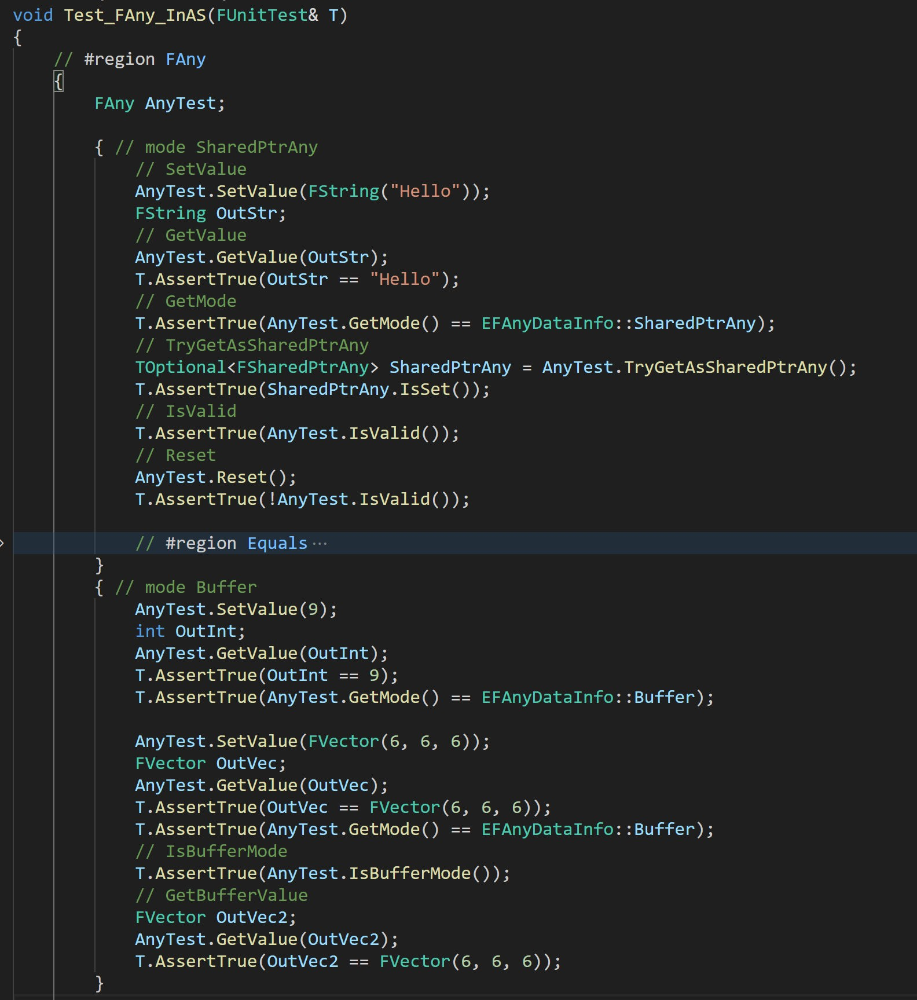
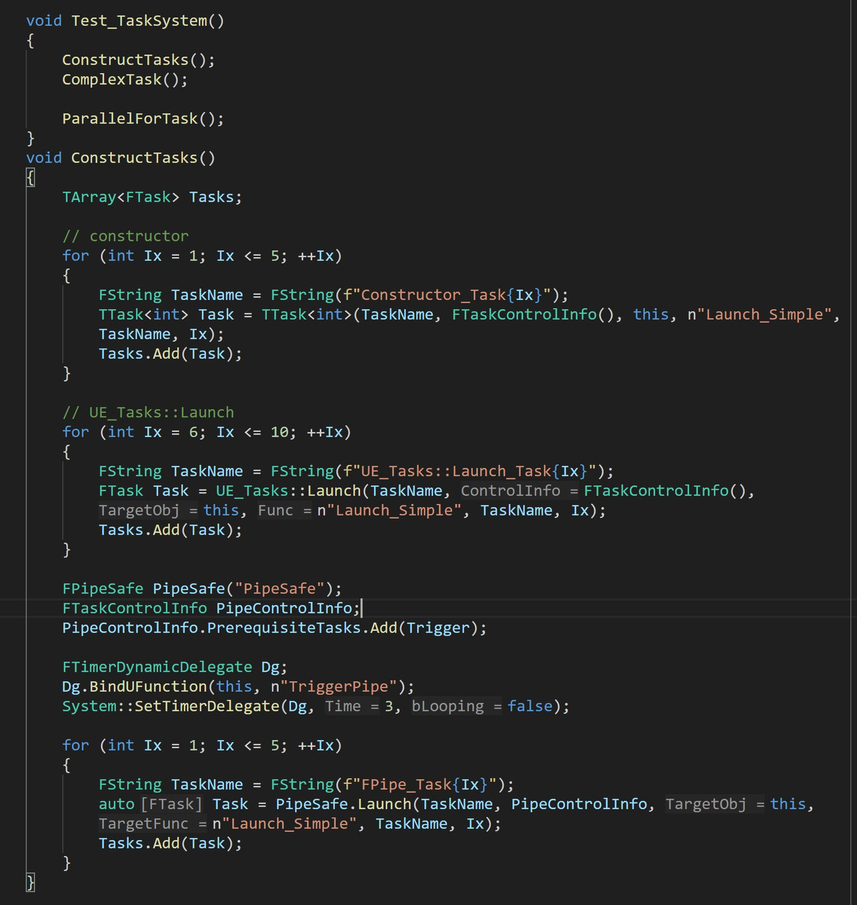
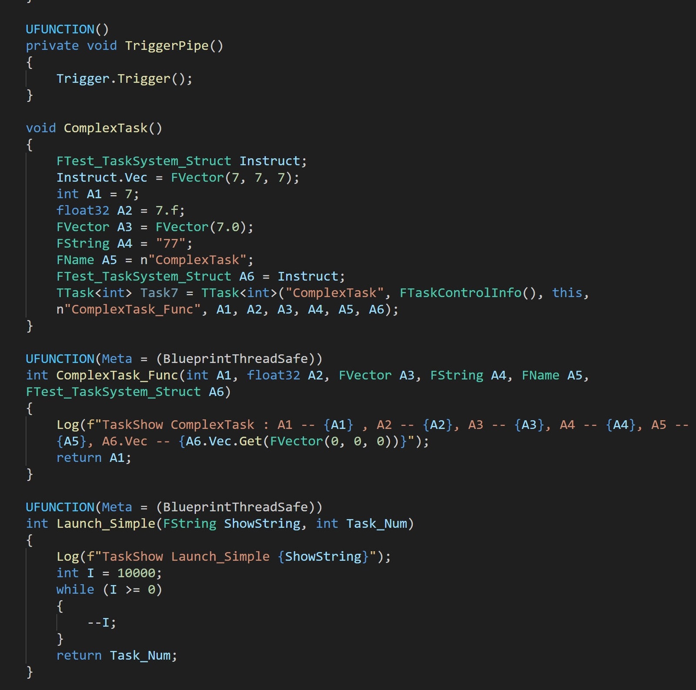
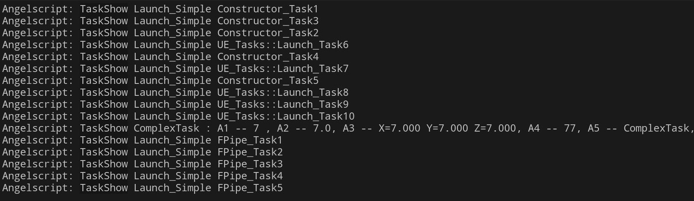

# A digression: dynamic types, async and multithreading in AngelScript — I want them all

Angelscript is a small, lightweight, statically typed scripting language. Some complex features are not supported, such as dynamic types, async and multithreading.

They may not be native features, but we can create them. Angelscript and C++ work well together. With C++’s direct control over memory, UE’s existing facilities, and the UE-Angelscript plugin’s glue layer, we can build safe, useful new features.

# Dynamic type FAny

This module mainly answers one question:
1. How do you store a value in a statically typed language when its concrete type is only known at runtime?

Adding dynamic-type behavior to a static language means handling the type’s memory yourself. There are precedents: C++’s `std::any` is a classic solution. This type occupies 64 bytes with 8-byte alignment. It buffers small types, keeping them on the stack and putting only larger types on the heap.

`std::any` is not suitable when chasing maximum performance; its memory footprint is relatively large. For infrequent calls, though, it performs well enough.

`std::any` provides no API to control its internal buffer size. The buffer is fixed and cannot be customized.
To shrink it further and control the overall object size, you need a similar implementation of your own.

A dynamic-type instance needs only two pieces of information to describe itself completely: the instance’s memory address and its type information. Use `RAII` to acquire and release resources so memory does not leak.

... Skipping a thousand words here ...

After several iterations, I finally had a type in UE-Angelscript that could “hold anything”: `int`, `float` and `UObject` all fit.

After weighing the options, the current container is 40 bytes in total, with a 24-byte buffer.
It could shrink to 32 bytes with a 16-byte buffer; with more complexity, it could go as low as 24 bytes in total with a 16-byte buffer.
Giving up buffering entirely and managing memory manually could theoretically bring it down to just 16 bytes.
But UE’s `FVector` is 24 bytes. A buffer that cannot even fit an `FVector` is not very useful, so keeping at least 24 bytes seems reasonable.

Still, FVector is currently 24 bytes in UE. A buffer too small to fit even FVector would be tiny, so at least 24 bytes remains the sensible choice.

# Async and multithreading: FTask | ParallelFor

This mainly answers two questions:
1. How can a script easily call a function asynchronously?
2. How can a script easily perform parallel calculations?

Unreal Engine already has async tools, most commonly subclasses of `UBlueprintAsyncActionBase`.
But adding an async feature in scripts means writing a `UObject` type to carry it, which is awkward and wastes performance.

UE C++ has many async tools, including the familiar `Async()` and `FAsyncGraph`. Some are too low-level and others too simple; each has its place. For scripts, I first ruled out the very low-level systems, and the overly simple ones did not offer much either.

I eventually chose the task system in the `UE::Tasks` namespace.
It is a newer, lightweight wrapper with a simple API.
There are still traps you have to fall into a few times to remember. Some types are not fully thread-safe, for example. The official comments say so, but apparently it takes a few crashes to make you really read that line. (Laughs.)

For parallel execution, I chose `ParallelFor`. That is more than enough for scripts.

Both `UE::Tasks` and `ParallelFor` produce results to retrieve. Those results can be all sorts of types, so a type that can hold anything is handy. That is why I needed a dynamic type in the first place.

... Skipping a thousand words here ...

After several iterations, the result looked like this.

The output — ignore the many ParallelFor lines:

Async works, and FPipe can control task ordering too.

# Summary

The dynamic-type module solves type erasure.
The implementation takes at least a thousand lines to cover all the details; memory operations are the main technical difficulty.
A small mistake can crash it. But a straight crash is actually good. An intermittent crash from undefined behavior is the real headache. (Laughs.)

Async and multithreading let scripts share the main thread’s workload, rather than leaving every performance bottleneck to C++.
This part takes roughly two or three thousand lines, mostly because of the complicated binding logic.
Even with plenty of macro magic to simplify it, it is still a sizeable chunk of code.

Getting these features working meant standing on giants’ shoulders. It was a difficult trip, but the destination was reachable.

This article only shows that the road exists. If you want to walk it yourself, I admire your courage and trust your ability — but take care of yourself.

Which one do you want: dynamic types, async, or multithreading?
All of them!
