# UE_Angelscript — Getting started: getting to know the engine again, familiar yet different

Continuing from [UE_Angelscript — Getting started: install the engine and open the sealed gate](getting-started-install-soloas.md).

- A surprised voice: You look unfamiliar. Who are you, and where did you come from?
- A puzzled voice: This seems familiar, but different. Where am I?
- Narration: “The peach-blossom haven has always been peaceful; only a rare encounter brings one here.”

# Preface

Before reading, you should have:

- Installed a UE_Angelscript engine that opens and works like the original UE engine.
- Installed VSCode and its UE_Angelscript extension.

These examples use UE_Angelscript 5.4, with the same environment as the previous article.

# Create a project

Create a project as usual, but choose the C++ version. Why? Later cpp helpers may be needed. This keeps low-level extension available and makes combining them with Angelscript easier.

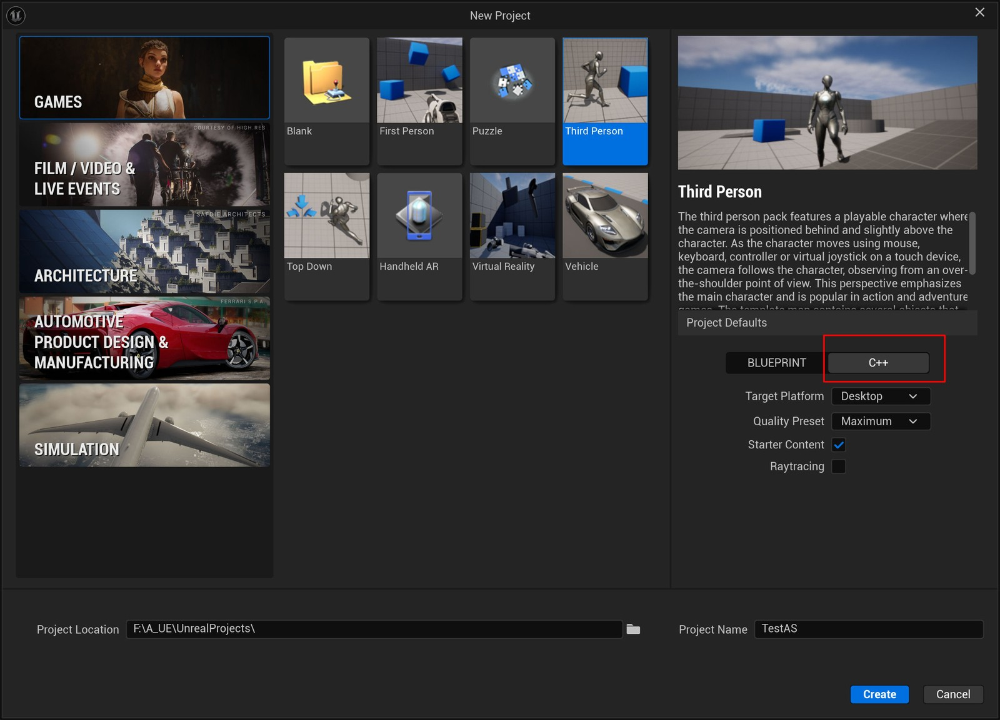

Creation opens the IDE. In Rider, for example, click Run at the upper right to compile and launch the project.

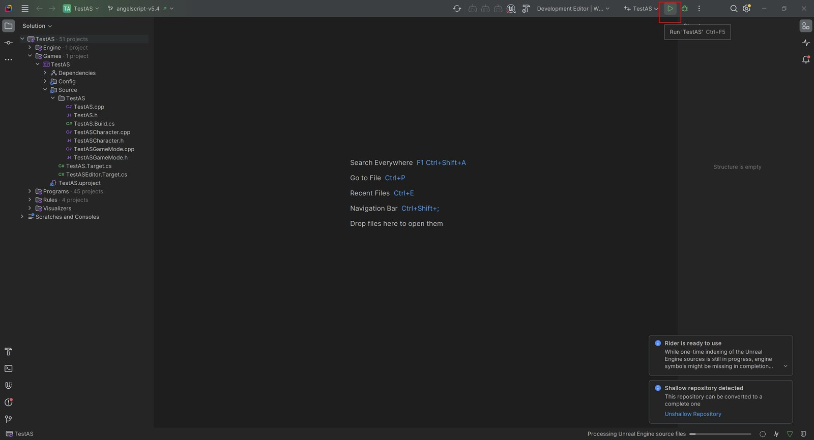

If all goes well, compilation opens the Editor. With Starter Content selected, many Shaders need compiling. This can be slow; sitting at 45% is normal. Do not panic: if it is still working, wait.

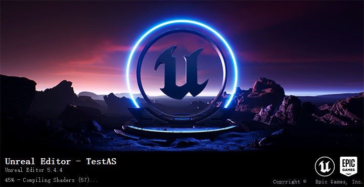

# Enter the workspace

In the engine’s Tools menu, a shortcut opens the Angescript workspace.

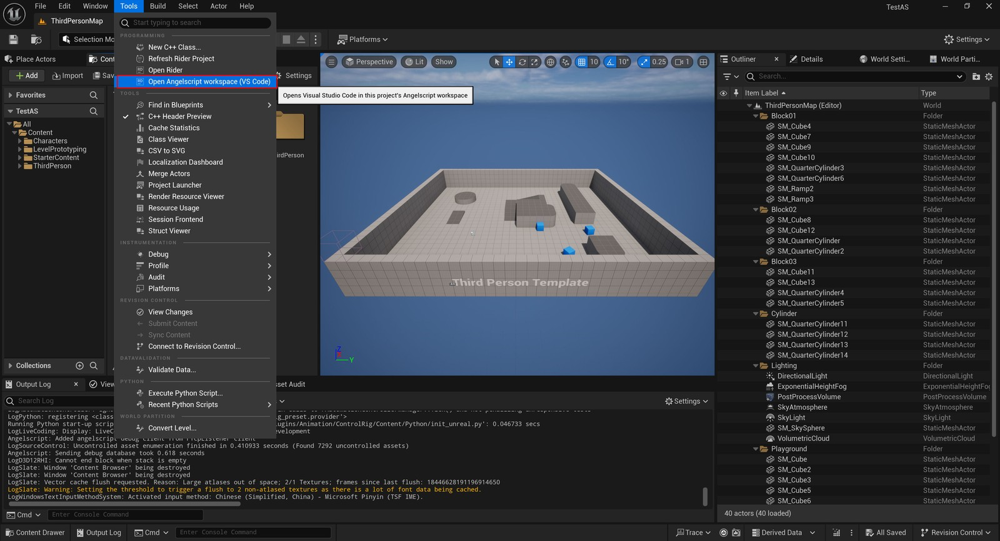

You can also open the project’s Script folder in VSCode directly. That folder is the Angelscript workspace.

VSCode initially looks empty because we have not created anything.

Remember the engine directory? Copy all its Examples files across, as below:

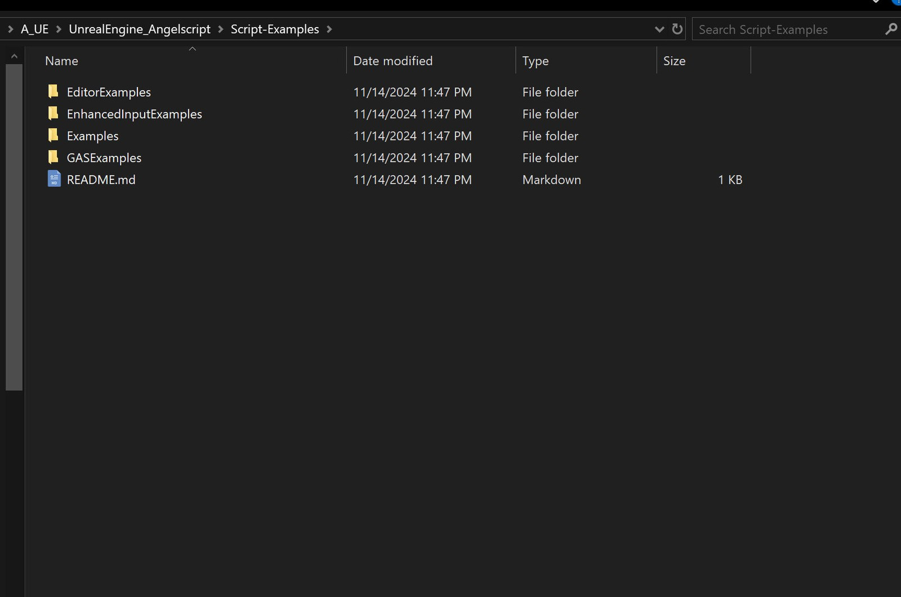

Start with the Examples folder. The others require additional plugins; beginners can ignore them for now.

Examples gives you extensively commented reference code to get started quickly.

Open Example_Actor.as:

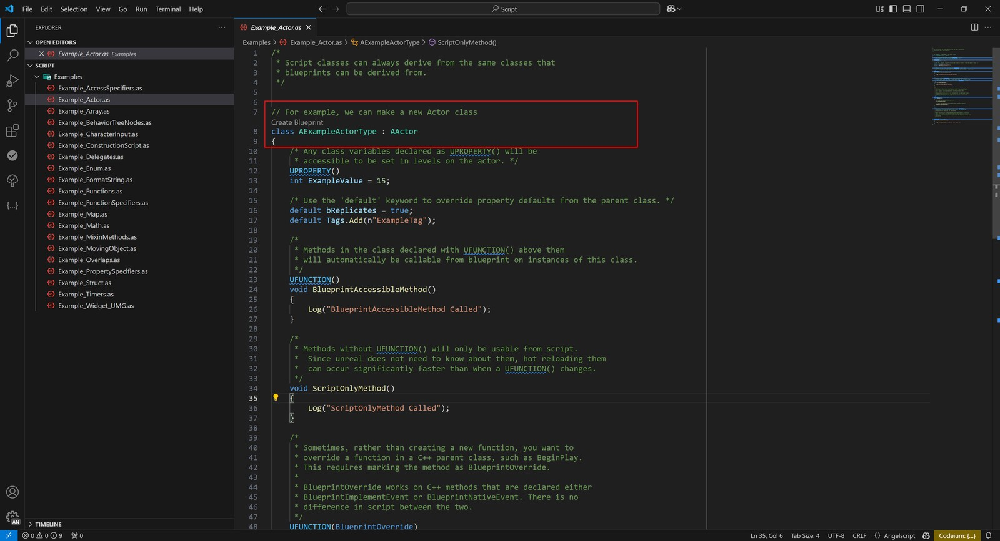

It contains AExampleActorType, derived from AActor. This is exposed to the Editor by default and appears when creating a Blueprint:

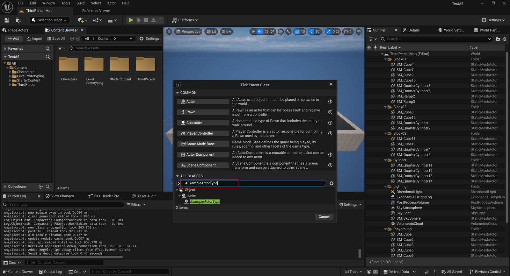

Copy a file, change the class name and try the features it describes, such as UPROPERTY.

Saving an error-free .as file applies the changes immediately in the Editor.

# Breakpoint debugging

Press F5 in VSCode to debug, then open the variables panel on the left.
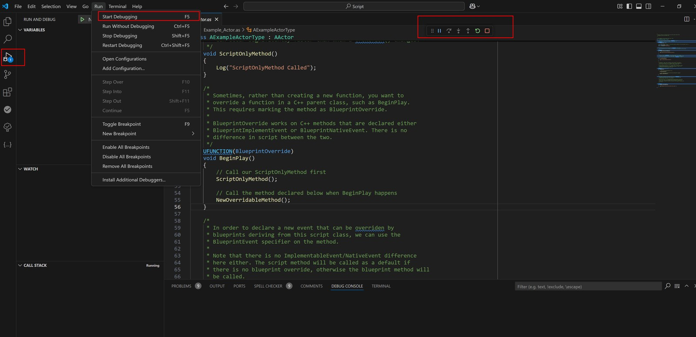

Set a breakpoint in BeginPlay or wherever you want to investigate:
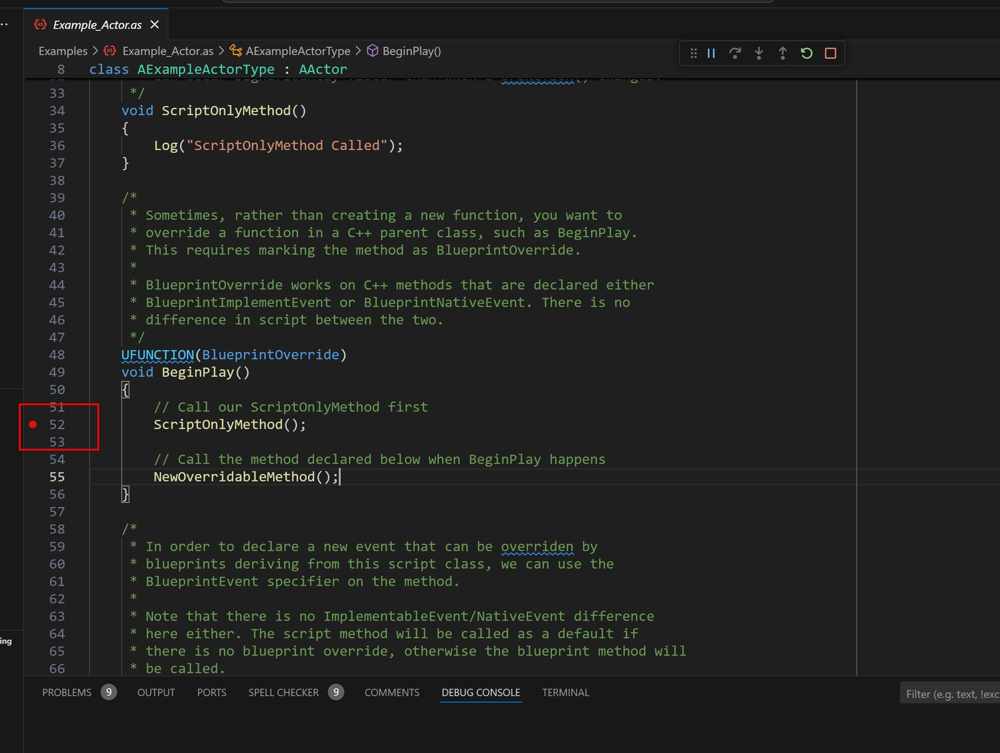

For example, create a Blueprint Actor derived from the example class and place it in the level. Running the Editor triggers the breakpoint.

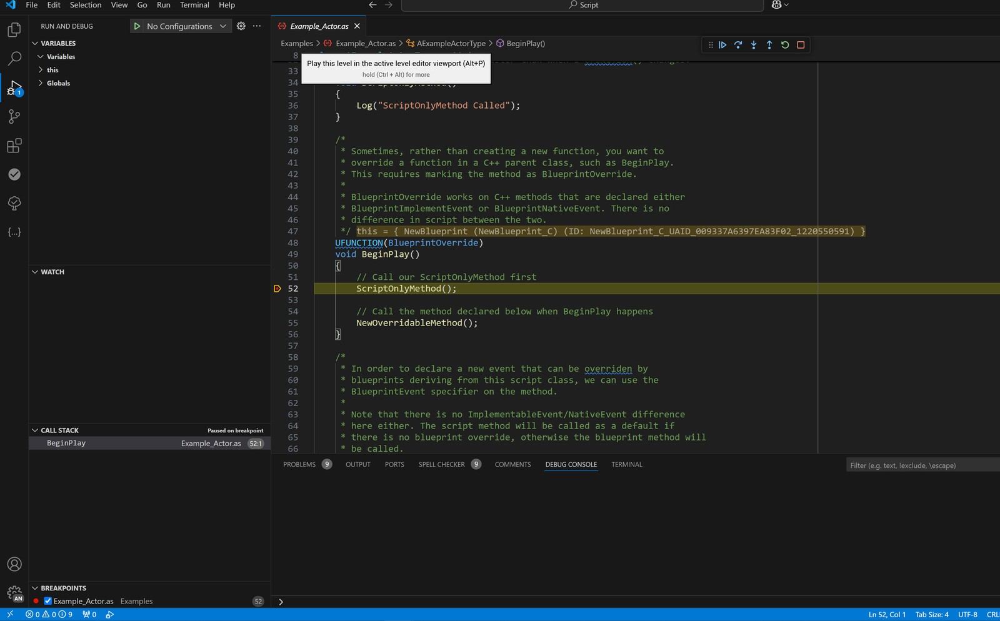

The small buttons at the upper right step through execution conveniently.
This resembles Blueprint breakpoint debugging.

# Seamless navigation

Original UE navigates from the Editor to C++ implementations. UE_Angelscript changes engine source to add navigation between the Editor and Angelscript. It can jump to code in VSCode and back to the corresponding Blueprint class in the Editor.

For example, click the parent-class link of a Blueprint inherited from an Angelscript class to jump straight to its implementation:

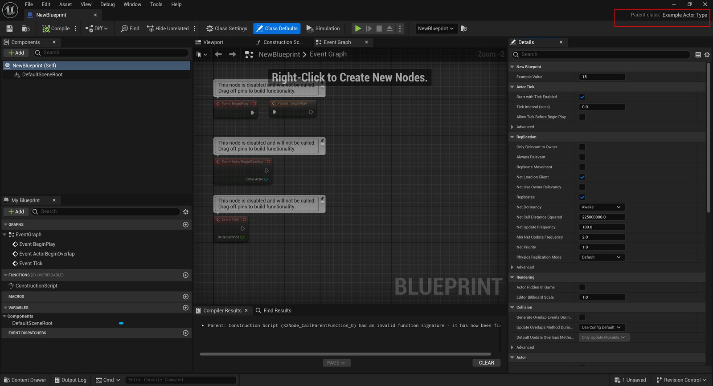

Conversely, clicking a class hint in Angelscript code can return to its Blueprint:

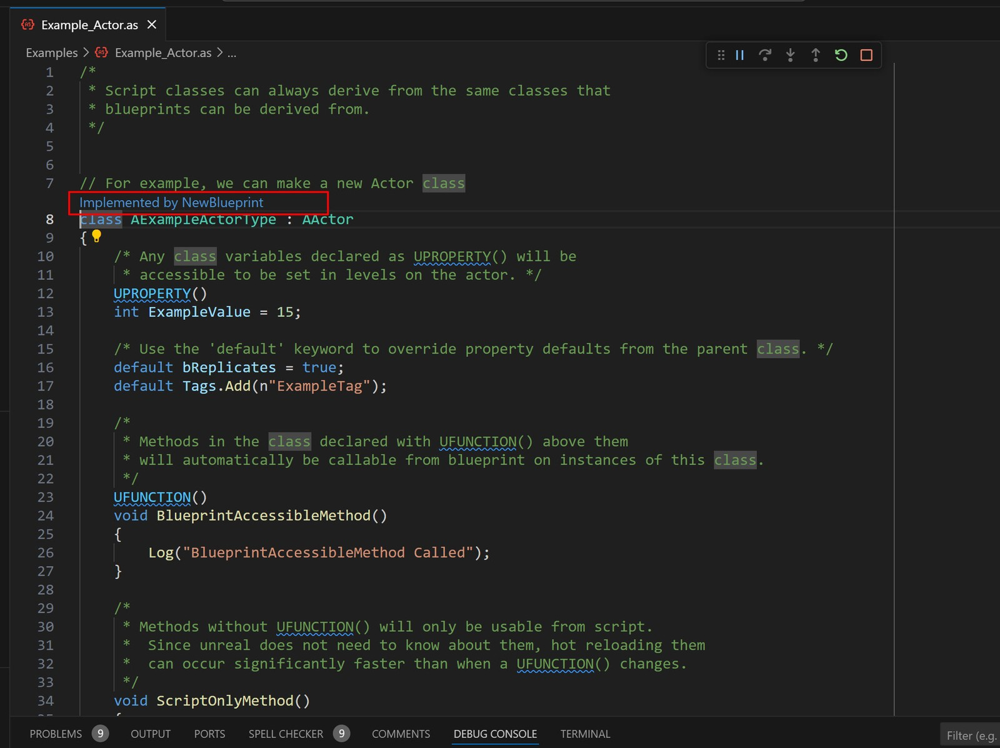

Editor component interaction and navigation to Actor instances in levels are supported too.

In short, Angelscript implements most cpp/Editor interactions, sometimes even more smoothly.

# Summary

These basic steps show an engine that looks like original UE but is tightly integrated throughout. Considerable work has gone into interaction, tailored for making games.

UE_Angelscript does not aim to replace Blueprints completely. It fills UE’s scripting-language gap as a layer between cpp and Blueprints.

Some say UE cpp already resembles a script and hot compilation is usable. True: UE C++ has many scripting traits, and some jokingly call it U++. But there is still too much boilerplate, plus headers and modules to manage. That should not dominate Gameplay work. Hot compilation is still not responsive enough: half a second and several seconds feel completely different. Every cpp build makes me wish for Blueprint-like immediate feedback.

UE is developing its own scripting language, and other third-party languages exist. Preferences differ. I want a maintained language proven in a project, with a good enough experience. UE_Angelscript happens to satisfy most of that.

Enjoy exploring UE_Angelscript. If this series helps, I am honored!
