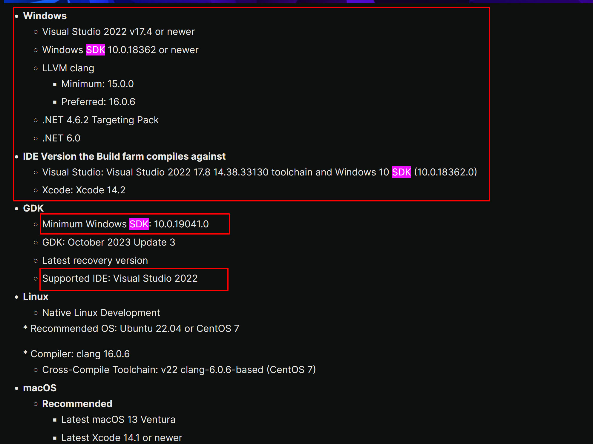
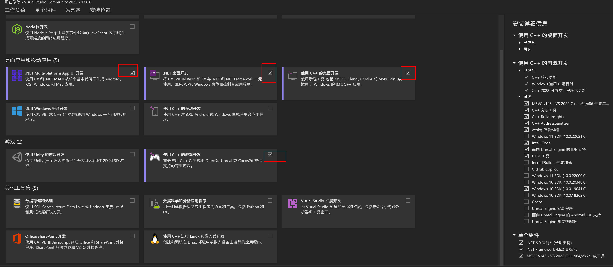
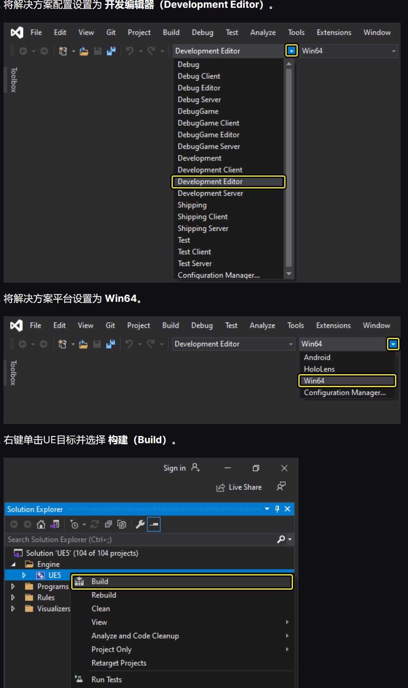
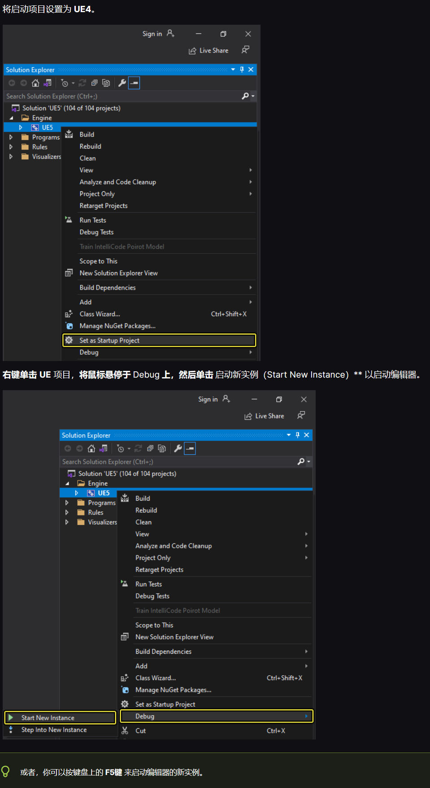

# UE_Angelscript — Getting started: install the engine and open the sealed gate

- An old voice: Warrior, there is a sealed gate ahead. Will you open it?
- A firm voice: If not, why did I come?
- Narration: “The world’s extraordinary sights often lie in difficult, distant places few people reach; only the determined can get there.”

# Preface

I recommend building UE-Angelscript yourself. These are some of my experiences, written with beginners in mind.

I assume the following knowledge. If something is unfamiliar, learning it when needed is fine too. UE’s documentation is detailed, and various AIs can help.

Basic knowledge: UE C++ fundamentals, basic Git, internet access and command-line use.
Hardware: a reasonably capable computer, otherwise compilation is slow.

For a quick trial, consider downloading a prebuilt version:
https://github.com/Hazelight/UnrealEngine-Angelscript

Get it from releases. Not every patch has binaries; UE 5.4, for example, only has UE 5.4.2.

That is sufficient if you rarely upgrade or modify the engine. For the latest version, learning the build process or modifying source, build it yourself.

# Configure the computer environment

## Check the requirements

First check the requirements for your UE version. Each may have specific requirements, and ignoring them makes build problems fairly likely. This link covers 5.4:

https://dev.epicgames.com/documentation/en-us/unreal-engine/unreal-engine-5.4-release-notes#developeriteration




```
Windows
    Visual Studio 2022 v17.4 or newer
    Windows SDK 10.0.18362 or newer
    LLVM clang
        Minimum: 15.0.0
        Preferred: 16.0.6
    .NET 4.6.2 Targeting Pack
    .NET 6.0

IDE Version the Build farm compiles against
    Visual Studio: Visual Studio 2022 17.8 14.38.33130 toolchain and Windows 10 SDK (10.0.18362.0)
    Xcode: Xcode 14.2

GDK
    Minimum Windows SDK: 10.0.19041.0
    GDK: October 2023 Update 3
    Latest recovery version
    Supported IDE: Visual Studio 2022
```

## Operating system: the build environment’s foundation

This version recommends Win10.
Win11 may work, but you may need to solve problems yourself.

## SDK: installable separately

For a reliable setup, do not casually choose the newest version. It may cause build problems — or it may not.
The screenshot above allows 18362 or 19041 for UE 5.4. I use the newer 19041.

Find **Windows Software Development Kit** in `Control Panel\All Control Panel Items\Programs and Features`. Check versions, uninstall unused ones and install a suitable version, 19041 here.

The default SDK directory is `C:\Program Files (x86)\Windows Kits`.
https://developer.microsoft.com/en-us/windows/downloads/sdk-archive/

Visual Studio can install this too; this is the separate installation route.

## LLVM clang: installable separately

Check with `clang --version`.

```
(base) PS C:\Users\YourHome> clang --version
(built by Brecht Sanders, r5) clang version 17.0.6
Target: x86_64-w64-windows-gnu
Thread model: posix
InstalledDir: D:/DEVELO~1/mingw64/bin
```

This is less critical.

Installation source: WinLibs standalone build of GCC and MinGW-w64 for Windows.
https://winlibs.com/

Visual Studio can install this too; this is the separate route.

## .NET: installable separately

Find it in `Control Panel\All Control Panel Items\Programs and Features`.

.NET 4.6.2 Targeting Pack:
https://dotnet.microsoft.com/zh-cn/download/dotnet-framework

.NET 6.0:

https://dotnet.microsoft.com/en-us/download/dotnet/6.0

## Visual Studio: the complete development environment

Visual Studio 2022 17.8, toolchain 14.38.33130.
Avoid casually updating it; rolling back is troublesome.
Choose the same SDK as for a separate installation.

Uninstall Visual Studio first, then select a specific version:
https://learn.microsoft.com/en-us/visualstudio/releases/2022/release-notes-v17.8
That page does not provide specific Community versions.

Use the following command to download one. Keep the network connection reliable.

```bash
# This is the command that shows all versions:
winget show --versions "Microsoft.VisualStudio.2022.Community"

# This example uses version 17.9.1; enter the following (remember to replace _17.9.1_ with the version you actually need to install):

winget install -v 17.9.1 "Microsoft.VisualStudio.2022.Community"

# (during the installation a prompt may appear: Do you agree to all the source agreement terms? [Y] Yes [N] No:

# If that prompt appears, enter **y** and press Enter to run.)
```

I install this version:

```bash
winget install -v 17.8.6 "Microsoft.VisualStudio.2022.Community"
```

After a while, the terminal produces a URL:
https://download.visualstudio.microsoft.com/download/pr/5bebe58c-9308-4a5b-9696-b6f84e90a32e/f125ea2f51f323f78d612b08a77134ce9f94e7a0c6e43041a1d13804651dc27e/vs_Community.exe

That is the installer exe for 17.8.6! If you only want that version, use the link directly.

After downloading the version-specific Installer, use this configuration package:



Remove the Win11 SDK and select the appropriate Win10 SDK.

Add the .NET 6 runtime and .NET Framework 4.6.2 targeting pack.

Select the Unreal Engine Test Adapter.

Choose `MSVC 143 - VS 2022 C++ x64/x86 Build Tools (v14.38-17.8)`. Visual Studio will prompt for it during compilation if omitted.

For more detailed installation steps, see the UE documentation:
https://dev.epicgames.com/documentation/zh-cn/unreal-engine/setting-up-visual-studio-development-environment-for-cplusplus-projects-in-unreal-engine?application_version=5.4

After installing the MSVC toolchain, add these directories to the system path:

```
C:\Program Files\Microsoft Visual Studio\2022\Community\VC\Tools\MSVC\14.38.33130

C:\Program Files\Microsoft Visual Studio\2022\Community\VC\Tools\MSVC\14.38.33130\bin\Hostx64\x64
```

On opening, an unconfigured environment may request `MSVC 143 - VS 2022 C++ x64/x86 Build Tools (v14.38-17.8)`. Install it. Perhaps it is a VC-tools patch; whatever it is, install it when prompted.

## Build configuration: optional, do not change casually

Replace the username in this path:
`C:\Users\YourHome\AppData\Roaming\Unreal Engine\UnrealBuildTool\BuildConfiguration.xml` configures many compilation options. Leave it alone if uninterested; defaults are provided.

A similar file exists under F:\A_UE\UnrealEngine_Angelscript_55\Engine\Saved\UnrealBuildTool.

This is my configuration for an AMD 5900X, 64GB RAM and VS 2022. PCH is still too high; I may lower it later. For unfamiliar parameters, ask AI to explain them, but do not trust every suggestion: it may recommend old settings.

```xml
<?xml version="1.0" encoding="utf-8" ?>
<Configuration xmlns="https://www.unrealengine.com/BuildConfiguration">
    <WindowsPlatform>
        <!-- increase the PCH memory allocation to suit large source trees -->
        <PCHMemoryAllocationFactor>600</PCHMemoryAllocationFactor>
    </WindowsPlatform>
    <ParallelExecutor>
        <!-- parallel build settings -->
        <ProcessorCountMultiplier>1</ProcessorCountMultiplier>
        <MaxProcessorCount>24</MaxProcessorCount>
    </ParallelExecutor>
    <BuildConfiguration>
        <!-- enable XGE or disable it, depending on whether distributed builds are available -->
        <bAllowXGE>false</bAllowXGE>
        <!-- maximum number of parallel build tasks -->
        <MaxParallelActions>24</MaxParallelActions>
        <!-- disable Unity Build to improve incremental build performance (enable it if you rarely modify the engine) -->
        <bUseUnityBuild>true</bUseUnityBuild>
        <!-- enable PCH support -->
        <bUsePCHFiles>true</bUsePCHFiles>
    </BuildConfiguration>
</Configuration>
```

Without overclocking, the AMD 5900X takes about 42 minutes for a full UE 5.4 build.

Changing PCHMemoryAllocationFactor regenerates precompiled headers and effectively recompiles some engine content. Once settled, avoid casually changing it and triggering another long wait.

Online reports put the default at 750. Setting mine to 1000 frequently causes errors.

# Build Unreal Engine yourself

### Build process

### Clone the repository

Reserve 256GB where the source build will live, preferably on an SSD.

Consider forking angelscript-master, or use the Angelscript repository directly.
Clone it:

```bash
git clone https://github.com/Hazelight/UnrealEngine-Angelscript.git
```

Cloning takes time. I created a v5.4 branch from the tag I needed:

```bash
git checkout -b angelscript-v5.4 tags/angelscript-5.4-last
```

The `angelscript-5.4-last` tag is actually version 5.4.4.

### Update dependencies

Setup.bat updates dependencies.
Generate project files with GenerateProjectFiles.bat.
Successful output looks like this:

```
F:\A_UE\UnrealEngine_Angelscript>F:\A_UE\UnrealEngine_Angelscript\Setup.bat
Checking dependencies...
Registering git hooks...
Installing prerequisites...

F:\A_UE\UnrealEngine_Angelscript>F:\A_UE\UnrealEngine_Angelscript\GenerateProjectFiles.bat
Setting up Unreal Engine project files...
Using bundled DotNet SDK version: 6.0.302
Log file: F:\A_UE\UnrealEngine_Angelscript\Engine\Programs\UnrealBuildTool\Log_GPF.txt

Some Platforms were skipped due to invalid SDK setup: Android, Linux, LinuxArm64.
See the log file for detailed information


Generating VisualStudio project files:
Binding IntelliSense data... 100%
Writing project files...
Forcing LEGACY XCODE because host OS is not Mac
Writing project files... 100%

Generating QueryTargets data for editor...
Total execution time: 7.13 seconds
```

### Start compiling

Open UE5.sln in Visual Studio.
Set the solution configuration to **Development Editor**.
Set the platform to **Win64**.
Right-click the UE target and choose **Build**.




### Run the Editor

After compilation, run the compiled editor.

Set **UE5** as the startup project.

**Right-click UE**, hover over **Debug**, then choose **Start New Instance** to launch the editor, or press F5.




If all goes well, the Editor opens normally. Use it much like official UE, except without direct Epic Games Launcher integration. Plugins need compiling yourself. But if we can compile an engine, a mere plugin is no problem.

# Configuration after compilation

## Where is the engine executable?

A script can launch it, though normally we launch a project rather than the engine by itself.

```bash
@echo off

cd /d %~dp0

start .\UnrealEngine_Angelscript\Engine\Binaries\Win64\UnrealEditor.exe

pause
```

Or make a desktop shortcut or pin it to the toolbar.

## Install third-party plugins

Place them under the engine directory, creating this path if needed:
~\Engine\Plugins\Marketplace
For development plugins such as RiderLink, use its Developer subdirectory:
~\Engine\Plugins\Marketplace\Developer

## Choosing and configuring an editor

### VSCode

- VSCode is required for writing UE-Angelscript code.

Install `Unreal Angelscript` and `Unreal AngelScript Clang-Format` according to the official documentation, then start exploring.

Press F5 to debug from VSCode. Run the Editor and step through breakpoints, much like Blueprints.

VSCode is open source, free and extensible, but UE projects are so large that loading the whole thing is slow. People generally avoid that. Official support exists, but configuration is awkward and navigation is sluggish.

For scripting, however, VSCode is an excellent fit. The UE-Angelscript extension bridges UE Editor and VSCode quickly. Short of massive refactoring, things open immediately, with no interruption — compared here with cpp hot compilation.

### Visual Studio

- Visual Studio is generally required too. It configures the environment conveniently, Community has enough features, and many UE optimizations exist. There are still annoyances, but commercial use is possible subject to restrictions.

Must the first engine build use Visual Studio? That is the official documented path. Setup and learning are relatively simple, and Community lets anyone try.

Some optional VS extensions and settings follow.

#### Open UE integration configuration

Tools → Options → Unreal Engine → Configuration Page → Show at startup → true.
That opens UE integration configuration.

#### vc-ue-extensions

https://github.com/microsoft/vc-ue-extensions
First install Visual Studio Tools for Unreal Engine through the VS Installer.
Clone the plugin into the engine’s Plugins/Marketplace directory, creating it if needed:

```
cd F:\A_UE\UnrealEngine_Angelscript\Engine\Plugins\Marketplace
git clone https://github.com/microsoft/vc-ue-extensions
```

Then compile UE5 in VS.

If Resharper C++ is installed, consider disabling VS Blueprint analysis; VS’s own analysis is not very accurate.

#### Naming convention checker

Configure it at the project root.
Generate .editorconfig in the project directory.
Copy the file from vc-ue-extensions:
https://raw.githubusercontent.com/microsoft/vc-ue-extensions/main/Source/.editorconfig

#### HLSL support

https://marketplace.visualstudio.com/items?itemName=TimGJones.HLSLToolsforVisualStudio
Then generate shadertoolsconfig.json in the project directory.

#### UnrealVS

Installer location:
`<UNREAL_ENGINE_ROOT>\Engine\Extras\UnrealVS\VS_VERSION\UnrealVS.vsix`
Installation and usage:
https://dev.epicgames.com/documentation/zh-cn/unreal-engine/using-the-unrealvs-extension-for-unreal-engine-cplusplus-projects

#### Favorite Documents

Add it through Extensions → Manage Extensions. Alternatively, download it, close VS and double-click to install.
https://marketplace.visualstudio.com/items?itemName=SergeyVlasov.FavoriteDocuments

#### Others

CodeMaid.VS2022, Resharper C++ (paid), VSCode Theme Converte.

### Rider

- Rider is worth considering. It has many UE optimizations and is much better than Visual Studio, but needs plenty of RAM to shine. The current personal version is for learning and research, not commercial use.

Can Rider compile projects? I tested it, and yes.

It has fewer freely installable extensions, but most UE-development features are present and some are excellent. With adequate hardware and a commercial license, it is a very good choice.

One workflow: build the engine initially in VS, then use Rider for later builds and cpp code, with VSCode for Angelscript.

# Things to watch

## Avoid accidentally changing engine source

Use a script to make `'.h', '.hpp', '.c', '.cpp', '.cs'` files under ~\Engine\Source\Runtime read-only. Do the same for Source\Editor if extending the Editor.

One iron rule, learned from others’ experience:
**Never use Visual Studio’s Clean or Rebuild on a source-built Unreal Engine solution!**

Can you create an installed binary build like the official one? Officially, yes, but that is another rabbit hole with complicated configuration. Try it if interested; relevant links follow.

Official documentation:
https://dev.epicgames.com/documentation/en-us/unreal-engine/installed-build-reference-guide-for-unreal-engine

Install the Windows 10 SDK and select Windows Debugging Tools:
https://developer.microsoft.com/en-us/windows/downloads/sdk-archive/

Find the matching SDK environment configuration:
https://dev.epicgames.com/documentation/en-us/unreal-engine/unreal-engine-5.4-release-notes#developeriteration

Important related code:

```bash
.\Engine\Build\BatchFiles\RunUAT.bat BuildGraph -target="Make Installed Build Win64" -script="Engine/Build/InstalledEngineBuild.xml" -clean

.\Engine\Build\BatchFiles\RunUAT.bat BuildGraph -script=Engine/Build/InstalledEngineBuild.xml -target="Make Installed Build Win64" -nosign -set:GameConfigurations=Development;Shipping -set:WithWin64=true -set:WithAndroid=false -set:WithDDC=true -set:WithLinux=false -set:WithLinuxArm64=false -set:WithIOS=false -set:WithTVOS=false -set:WithMac=false -clean

```

There is also an online trick to make the engine identify itself as installed. In my tests it was not very useful. Reverting it may trigger a full engine build.
Still, here it is in case it helps later:
Rename SourceDistribution.txt under `~\Engine\Build` to InstalledBuild.txt.
InstalledBuild.txt can contain AS_5.4, though that seems to do little.

Afterward, right-clicking a project and switching engine versions shows `Binary build at (path)`.
## Cleaning a source-build project

Project-level cleanup for a source-built engine:

1. Delete **Binaries**, **Build**, **DerivedDataCache**, **Intermediate** and the **sln** file at the project root.

2. Regenerate Visual Studio project files through .uproject. This recreates **sln** and **Intermediate**.

3. Open the solution, set the game project as startup and Build it — especially, do not Rebuild. This recreates **Binaries** and **Build**.

4. Run the project. Opening the Editor recreates **DerivedDataCache**.

5. Always remember:

**Never use Visual Studio’s Clean or Rebuild on a source-built Unreal Engine solution!**

**Never use Visual Studio’s Clean or Rebuild on a source-built Unreal Engine solution!**

**Never use Visual Studio’s Clean or Rebuild on a source-built Unreal Engine solution!**

Yes, it cannot be repeated too often!

### Hidden bonus!

Cleaning files is common during development. Deleting those folders manually every time became tiring, so I wrote a script. Put it in the project directory and it cleans that project following the steps above. Recompile afterward for a completely fresh build.

Why? When a compilation error is hard to explain, or mysterious runtime errors appear, this can work wonders.

Here is the code. Consider backups before running it and accept the risk yourself. Working perfectly on my machine does not mean it will on yours. Remember that.

Change `ENGINE_ROOT` to your engine directory, otherwise regenerating Visual Studio project files will not work!

```shell
:: One-click cleanup of UE project files; the project can be rebuilt afterwards
@echo off
:: Set the project root path (defaults to the directory of this script)
set PROJECT_ROOT=%~dp0

:: Set the engine root path (change it to match your setup)
set ENGINE_ROOT=your engine directory, for example F:\UE\UnrealEngine_Angelscript

:: Switch to the project root
cd /d "%PROJECT_ROOT%"

:: Define the folders and files to delete
set FOLDERS_TO_DELETE=Binaries Build DerivedDataCache Intermediate
set FILES_TO_DELETE=*.sln

:: Announce the operation about to run
echo Cleaning up the following:
for %%F in (%FOLDERS_TO_DELETE%) do echo    Folder: %%F
for %%F in (%FILES_TO_DELETE%) do echo    File: %%F

:: Delete folders
for %%F in (%FOLDERS_TO_DELETE%) do (
    if exist "%%F" (
        echo Deleting folder: %%F
        rmdir /s /q "%%F"
    ) else (
        echo Folder %%F does not exist, skipping.
    )
)

:: Delete files
for %%F in (%FILES_TO_DELETE%) do (
    echo Deleting file: %%F
    del /q "%%F"
)

:: Check whether a .uproject file exists
set UPROJECT_FILE=
for %%F in (*.uproject) do set UPROJECT_FILE=%%F

if "%UPROJECT_FILE%"=="" (
    echo No .uproject file found; cannot regenerate the project files.
    pause
    exit /b 1
)

:: Regenerate the Visual Studio project files
echo Regenerating the Visual Studio project files...
"%ENGINE_ROOT%\Engine\Binaries\DotNET\UnrealBuildTool\UnrealBuildTool.exe" -projectfiles -project="%PROJECT_ROOT%%UPROJECT_FILE%" -game

echo Cleanup finished!
pause
```

# Summary

Building the engine is a good way to learn UE more deeply. A UE project is fundamentally a cpp project combining engine modules and project modules.

Building the engine and trying custom modules makes development feel like adding our own blocks to an existing set.

Only a source build also lets you freely modify engine content — carefully, carefully.
