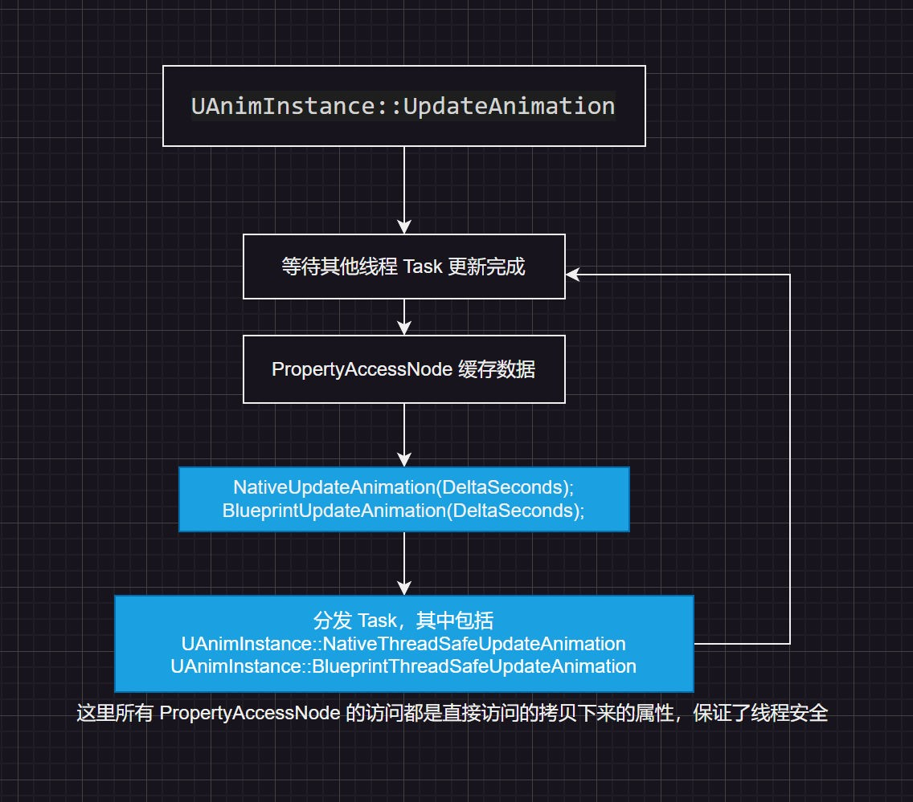

# UE_Angelscript — Extending Animation Blueprints: write the main calculations in code

Animation is usually easier to debug in Blueprints because immediate feedback matters so much. UE has optimized Animation Blueprints extensively, but those are underlying optimizations. New logic added to the graph still runs on the Blueprint VM.

A scripting language faster than Blueprints, yet with immediate feedback, can balance development speed and performance. Tests show Angelscript can extend Animation Blueprints.

Scripting languages cannot replace the Animation Blueprint VM, so they are mostly an auxiliary tool here.

# What Angelscript adds to Animation Blueprints

1. People who prefer text will use a script instead of wiring nodes whenever possible. This serves that group. I will spare you the version-control and diffing argument; anyone who writes code knows it.

2. If the Animation Blueprint does not use multithreaded calculations — the optimization enabled in projects such as Lyra — its calculations may become a bottleneck. Moving some code to Angelscript may help noticeably. This is an inference from AngelScript’s speed advantage over Blueprints; the actual result still needs testing.

3. If the Animation Blueprint does use multithreaded calculations, as in Lyra, calculations happen off the game thread. Angelscript’s performance improvement will be less noticeable. This is also an inference from its speed advantage and needs real testing.

# Writing Animation Blueprint functions with Angelscript

Broadly, it works much like other Blueprints.

1. Derive a class from UAnimInstance, then make the Animation Blueprint inherit from that AS class.

2. Functions marked UFUNCTION() can be called by the Animation Blueprint. When multithreaded updating is enabled, add Meta = (BlueprintThreadSafe).

3. BlueprintThreadSafe tells the Blueprint that this function is thread-safe and can run on another thread. Making that true is your responsibility. There is a section on that below.

4. State-node labels and function prefixes must be correct to be recognized and used.

```cpp
    // Function parameters must be marked with &, a mutable reference, otherwise they cannot be recognized in the Blueprint details panel. Same below.
    UFUNCTION(BlueprintCallable, Meta = (BlueprintThreadSafe))
    void UpdateIdleState(FAnimUpdateContext& InContext, FAnimNodeReference& InNode)
```

5. Many BlueprintInternalUseOnly functions need exposing to AS before they can be called. The binding articles in this series have a dedicated explanation of exposing these functions.

6. Cpp handles animation nodes through many Blueprint function libraries, which are less direct to call. Mixins can make them easier to use in AS.

```cpp
mixin bool
IsStateBlendingOut(const FAnimNodeReference& InNode, const FAnimUpdateContext& InContext)
{
	return InNode.ConvertToAnimationState().IsStateBlendingOut(InContext);
}

// after that you can call the function like this
bool bIsStateBlendingOut = InNode.IsStateBlendingOut(InContext);
```

# Multithreaded animation is the hardest part

The challenge is understanding UE’s multithreaded animation call flow. That takes some work.

## How Animation Blueprints cache data for non-game threads

Lyra uses Property Access nodes heavily. UE really buried the pain in code for the animators’ happiness with this one.

After sorting through it, this is roughly how Property Access data caching runs during animation:



Property Access caches the data that needs game-thread access, avoiding races and keeping it thread-safe. This is Blueprint-specific: during compilation, Blueprint finds these Property Access nodes and generates code. Yes, generated code — think of it as another kind of macro.

Cpp has two ways to cache data for thread safety:
1. Read it from the UStruct called FAnimInstanceProxy. This Proxy synchronizes core animation data such as GetActorTransform, making that data safe to read there.
2. Cache the needed data manually in a derived UAnimInstance or FAnimInstanceProxy, updating it in NativeUpdateAnimation. Only copy data there; do not do excessive calculations.

## How AS caches data for non-game threads

AS is much like cpp here, except it cannot derive from FAnimInstanceProxy. Most data therefore goes in a derived UAnimInstance, updated in BlueprintUpdateAnimation.

Binding FAnimInstanceProxy functions also lets scripts read some core data and saves writing that cache code.

Below, AS calls FAnimInstanceProxy functions and compares them with manually cached core data. The two logs match.

```cpp
// call a function in FAnimInstanceProxy from AS
System::LogString(f"GetProxyOnAnyThreadBP : {GetProxyOnAnyThreadBP().GetActorTransform().GetLocation()}");

// the core data is cached by itself; CacheOwningActorData is a UStruct defined in AS
System::LogString(f"CacheOwningActorData : {CacheOwningActorData.ActorLocation}");

// CacheOwningActorData is updated in the BlueprintUpdateAnimation function.

// Print tests show that both update in sync and the output is identical.
```

That supports the conclusion that Proxy updates the Actor’s location in real time. Binding Proxy is useful: it saves synchronizing some cached data yourself.

# Where AS falls short for Animation Blueprints

1. Animation Blueprint interfaces are unsupported.

AS disables UE interfaces altogether, including Animation Blueprint interfaces. That leaves few ways for the main animation graph and animation-layer interfaces to interact.

Fortunately, I never intended to write all animation logic in pure code. State machines still have no replacement.

2. AS classes can be inherited by Blueprints, but not the other way around, which complicates interaction.

This becomes a problem when AS cannot hold all the main logic or an existing Animation Blueprint cannot be rewritten wholesale.

Calling existing Animation Blueprint functionality is manageable for ordinary types: pass parameters and modify them. Blueprint structs or enums used by that animation make it awkward.

For now, if handling it in AS is too complicated, fill the gap with Blueprints.

3. Property Access is useful, but AS cannot use it.

Cpp cannot use it either, but has FAnimInstanceProxy. AS needs bindings for FAnimInstanceProxy and cannot inherit it. That leaves AS behind Blueprints and Cpp for caching game-thread data.

# Related extension — Animation Notifies can be entirely AS

An Animation Notify is just an ordinary Blueprint. Writing it in AS is no problem.

# Related extension — BlueprintSafe functions

UAnimInstance has 45 BlueprintSafe functions, many usable directly in multithreaded update nodes, in UE 5.4.4.

```cpp
1: WasAnimNotifyTriggeredInStateMachine
2: WasAnimNotifyTriggeredInSourceState
3: WasAnimNotifyTriggeredInAnyState
4: WasAnimNotifyStateActiveInStateMachine
5: WasAnimNotifyStateActiveInSourceState
6: WasAnimNotifyStateActiveInAnyState
7: WasAnimNotifyNameTriggeredInStateMachine
8: WasAnimNotifyNameTriggeredInSourceState
9: WasAnimNotifyNameTriggeredInAnyState
10: RequestTransitionEvent
11: QueryTransitionEvent
12: QueryAndMarkTransitionEvent
13: IsSyncGroupBetweenMarkers
14: IsSlotActive
15: HasMarkerBeenHitThisFrame
16: GetTimeToClosestMarker
17: GetSyncGroupPosition
18: GetRelevantAnimTimeRemainingFraction
19: GetRelevantAnimTimeRemaining
20: GetRelevantAnimTimeFraction
21: GetRelevantAnimTime
22: GetRelevantAnimLength
23: GetInstanceTransitionTimeElapsedFraction
24: GetInstanceTransitionTimeElapsed
25: GetInstanceTransitionCrossfadeDuration
26: GetInstanceStateWeight
27: GetInstanceMachineWeight
28: GetInstanceCurrentStateElapsedTime
29: GetInstanceAssetPlayerTimeFromEndFraction
30: GetInstanceAssetPlayerTimeFromEnd
31: GetInstanceAssetPlayerTimeFraction
32: GetInstanceAssetPlayerTime
33: GetInstanceAssetPlayerLength
34: GetDeltaSeconds
35: GetCurveValueWithDefault
36: GetCurveValue
37: GetCurrentStateName
38: GetAllCurveNames
39: GetActiveCurveNames
40: ClearTransitionEvents
41: ClearAllTransitionEvents
42: CalculateDirection
43: BlueprintThreadSafeUpdateAnimation
44: Blueprint_GetSlotMontageLocalWeight
45: Blueprint_GetMainAnimInstance
```

---
