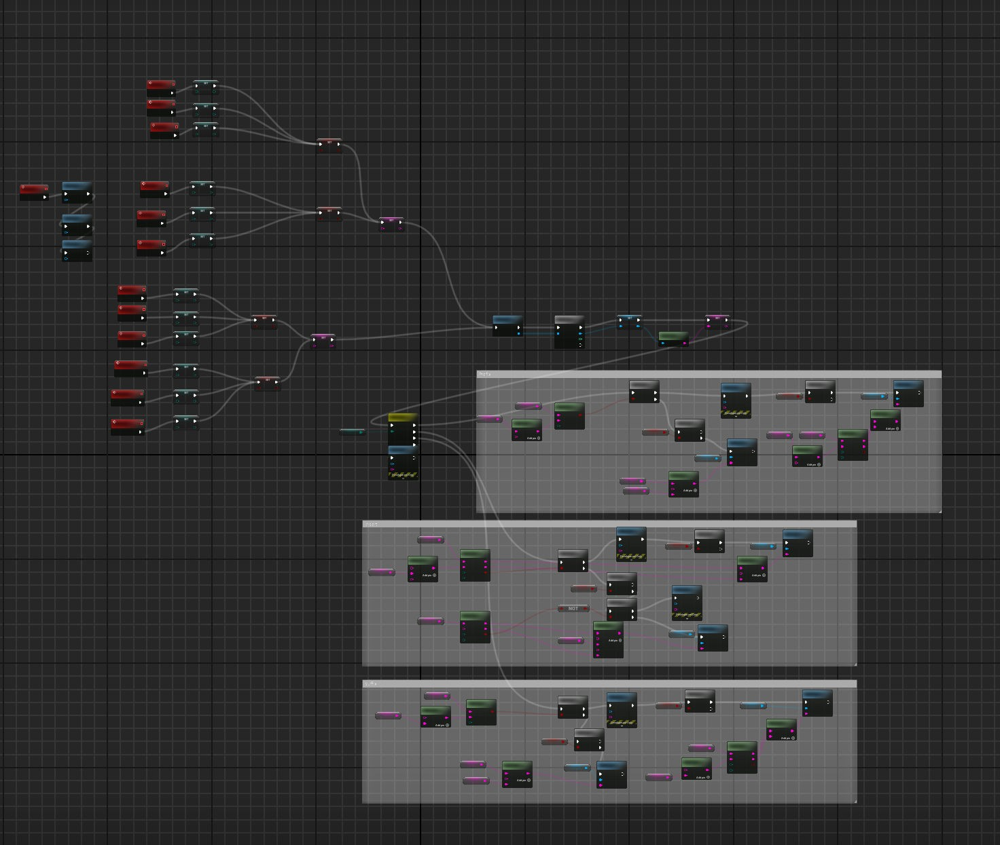
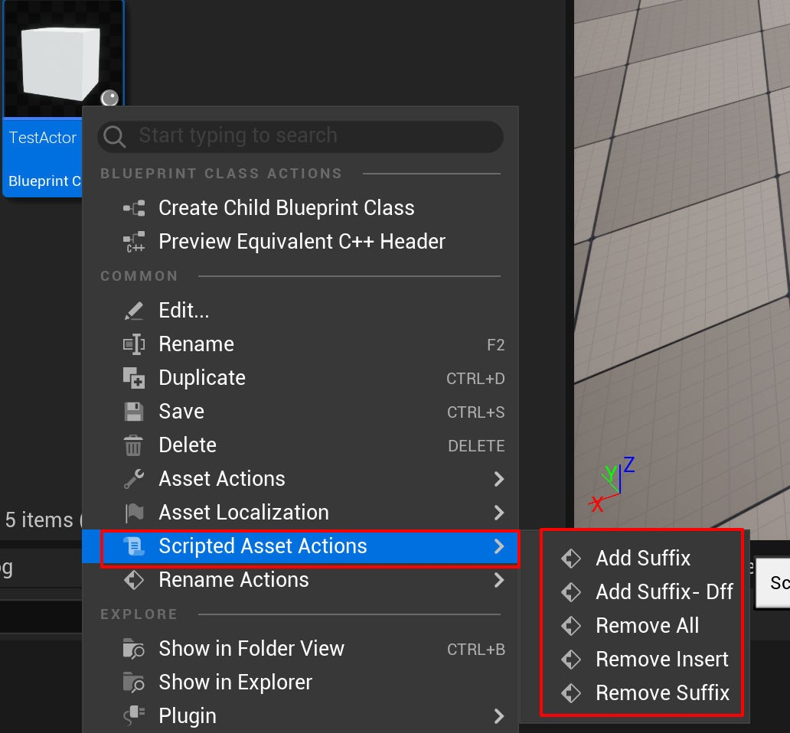
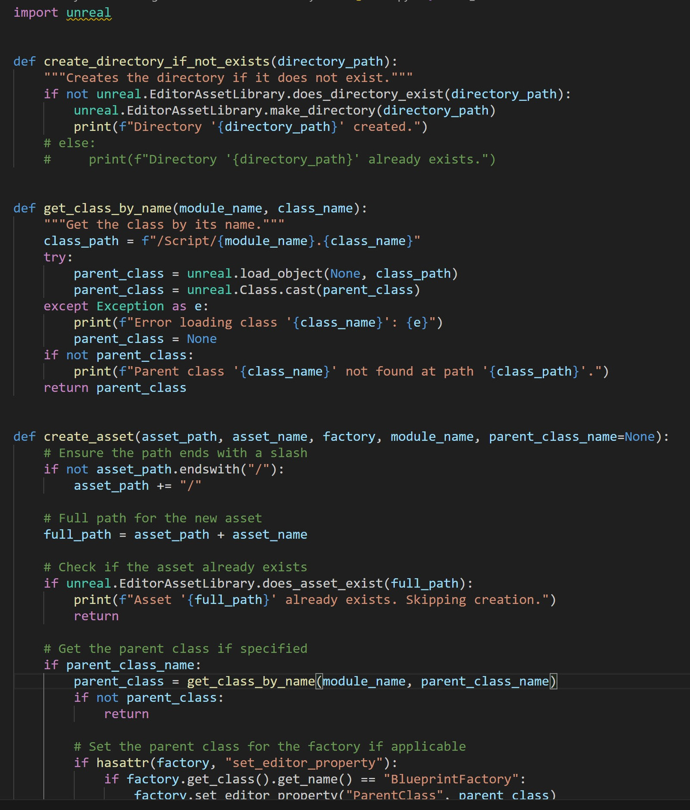
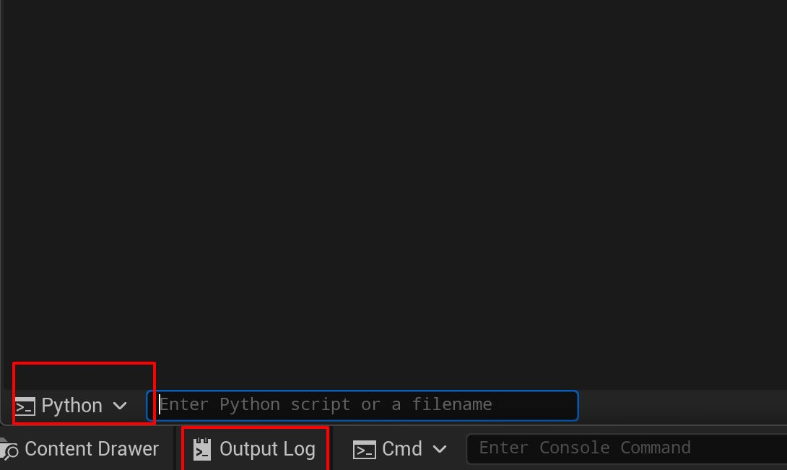
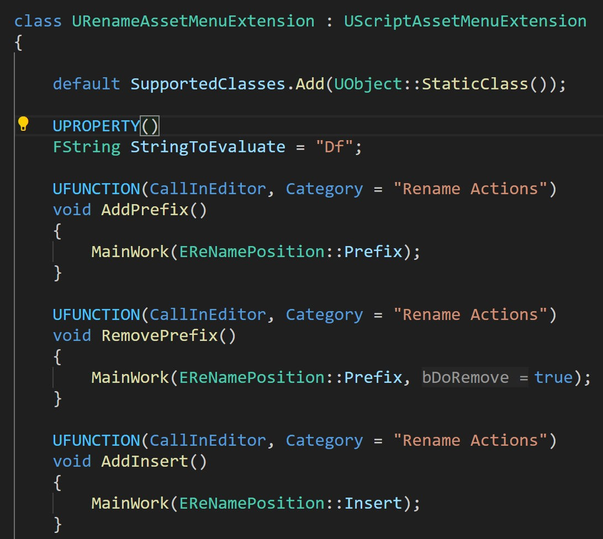
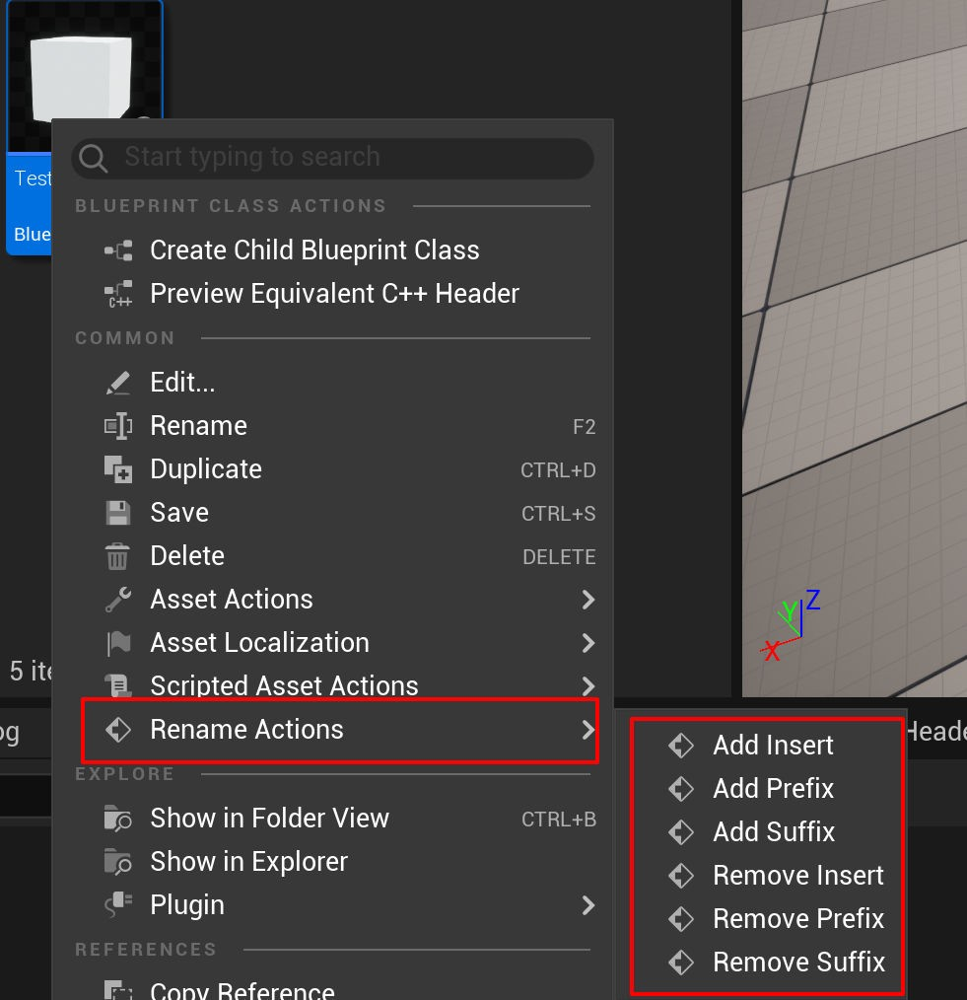
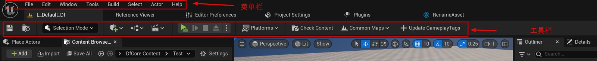

# UE_Angelscript — Extending the Editor is as easy as drinking water

Sometimes I want a small Editor feature, but writing it in cpp is a hassle. Unless necessary, I take one look and do not want to write it.

What about batch work? Do it manually, one item at a time? Absolutely not.

Previously I used Python scripts or Blueprints. Those are just the two approaches listed here; there are surely other tricks. All roads lead to Rome — the question is how tiring the walk is.

# Old approach 1: Blueprints

I once wrote plenty of Blueprint code to rename Assets in batches, adding prefixes and suffixes. After looking at the tangle of wires, I thought: I am not changing this again. Good enough.




# Old approach 2: Python

I used Python to add assets in batches. It was convenient to write, with AI helping inspect and modify it. Some parts were written by AI and checked by me. Using it was less convenient.

Code and usage:




To run it, first put a Python folder under some Content directory, then enter a console command. That is fine for rarely used features, but not efficient for something you click every so often.

# New approach: Angescript’s very simple interaction

### Asset actions in the Content Browser

- Create an .as file and wrap all Editor-only content in `#if EDITOR` and `#endif`.
  Do not worry about forgetting: the editor will kindly remind you. Quite considerate.

- Declare a class derived from `UScriptAssetMenuExtension`. The official example is:

```cpp
/**
 * Using UScriptAssetMenuExtension allows adding options to the context menu
 * of assets in the Content Browser.
 */
class UExampleAssetMenuExtension : UScriptAssetMenuExtension
{
	// These options should only show up for textures
	default SupportedClasses.Add(UTexture2D::StaticClass());

	// When clicked, will be called once for every selected texture asset
	UFUNCTION(CallInEditor, Category = "Example Texture Actions")
	void ExampleModifyTextureLODBias(FAssetData SelectedAsset, int LODBias = 0)
	{
		UTexture2D SelectedTexture = Cast<UTexture2D>(SelectedAsset.GetSoftObjectPath().TryLoad());
		SelectedTexture.Modify();
		SelectedTexture.LODBias = LODBias;
	}
};
```

The class name `UExampleAssetMenuExtension` is arbitrary and does not affect the Editor display. The `default` statement chooses the assets to handle: textures in this example. To handle most assets, use `default SupportedClasses.Add(UObject::StaticClass());`.

Each function is an asset operation. Category groups them. I group several functions under RenameActions, for example:




Functions with parameters open an input dialog when clicked. Even parameters with defaults still produce a dialog.

## Actor actions in the Level Outliner

This is much like Content Browser actions, except the base is `UScriptActorMenuExtension`. As the name suggests, it handles Actors, which are what levels contain.
The official example also shows custom icons:

```cpp
UCLASS(Abstract) // Remove this line to make the extension Enabled
class UExampleActorMenuExtension : UScriptActorMenuExtension
{
	// Specify one or more classes for which the menu options show
	default SupportedClasses.Add(AActor::StaticClass());

	// Every function with the CallInEditor specifier will become a context menu option
	UFUNCTION(CallInEditor)
	void ExampleActorMenuExtension()
	{
	}

	// The function's Category will be used to create sub-menus
	UFUNCTION(CallInEditor, Category = "Example Category")
	void ExampleOptionInSubCategory()
	{
	}

	// Custom icons can be specified with the `EditorIcon` meta tag:
	UFUNCTION(CallInEditor, Category = "Example Category", Meta = (EditorIcon = "Icons.Link"))
	void ExampleOptionWithIcon()
	{
	}
```

The icon is specified through Meta and comes from UE’s existing icons. I have not needed truly custom icons; readers can investigate that themselves.

## Menu and toolbar buttons

The menu bar is the top row; the toolbar is beneath the tabs.
Use menus for many nested actions and toolbars for frequently used ones.
I added an Update GameplayTags button to reload GameplayTags after editing the .ini files outside the editor:


Menus and toolbars share one class, so their syntax differs slightly.

### Main menu

```cpp
/**
 * Other editor menus can be extended with UScriptEditorMenuExtension.
 */
UCLASS(Abstract) // Remove this line to make the extension Enabled
class UExampleEditorMenuExtension : UScriptEditorMenuExtension
{
	// This is the same extension point used by UToolMenus::ExtendMenu
	// In this example, we extend the top menu of the main window:
	default ExtensionPoint = n"MainFrame.MainMenu";

	UFUNCTION(CallInEditor, Category = "My Example Menu")
	void ExampleMainMenuOption()
	{
	}

	UFUNCTION(CallInEditor, Category = "My Example Menu | Example Sub Menu")
	void ExampleSubMenuOption()
	{
	}
};
```

`ExtensionPoint` is fixed here: it explicitly targets MainMenu. Category is the displayed menu name and supports nesting with the `|` separator.

### Toolbar: LevelEditorToolBar

Here, `ExtensionPoint` explicitly names `LevelEditorToolBar` too.

That raises a question: are other ExtensionPoints available? If so, why not show them in the official examples? I have not studied this implementation deeply. Then again, do we really need more? Are these enough for now? Yes.

# The advantages of extending the Editor with Angelscript

This does not mean the other approaches are bad. I am considering convenience. Cpp, Blueprint and Python experts probably have convenient workflows too — experts have tricks up their sleeves.

## Advantages

- Very fast iteration. Nearly as fast as Blueprints: press Ctrl+S and test.
- Simple to invoke. Much like native buttons, without entering commands.
- Easy extension code. Inherit a class, add a default statement and start writing methods.
- Reasonable safeguards. Forget to wrap the classes in an #if and you will be taught a lesson.
- Text format, yes! That helps version control and reflects a basic point: text can carry far more information than visual-node programming.

## Disadvantages

- Only available in the AS engine fork. This is not something you get by installing a simple plugin. The maintainers provide binaries for some versions, not every patch; UE 5.4 only has UE 5.4.2, for example.
- Less universal than cpp. Some modules still need cpp functions. My ini-reloading feature was unavailable in AS, so I wrote it in cpp.
- Less friendly than Blueprints. It takes a bit more programming knowledge.

# Bonus: Editor --> Angescript --> cpp --> .bat

One last bonus: run a .bat file with one Editor click. Open up the channels, and those accumulated old batch files can fly again.

Write a cpp function that runs a .bat through Windows cmd, then expose it to AS or Blueprints.

Combine that with an Editor extension and one click runs the file.

Why? I have accumulated carefully built batch files and want to keep them useful. Update GameplayTags converts an xls spreadsheet into ini files through a .bat, then reloads them into UE. The bridge function below deserves much of the credit.

```cpp
/// .h file

/** Static method for running a .bat file from Blueprints. It needs an absolute path, and the path must use / .  
 * the bat file should end with timeout /t 1 /nobreak >nul, or use ping, to delay slightly,  
 * so that this process can read what the cmd window outputs; do not write pause.  
 * A bat file must not switch from a normal user to administrator; otherwise the run counts as finished and the current process is not blocked while reading the output  
 **/
 **/UFUNCTION(BlueprintCallable, Category = "Utilities")
static void RunBatchFile(const FString& BatchFilePath);

/// .cpp file
void UExampleEditorFunctionLibrary::RunBatchFile(const FString& BatchFilePath)
{
	// check whether the file exists
	if (!FPaths::FileExists(BatchFilePath))
	{
		UE_LOG(LogTemp, Error, TEXT("Batch file does not exist: %s"), *BatchFilePath);
		return;
	}

	// set the working directory (use the directory of the batch file)
	FString WorkingDirectory = FPaths::GetPath(BatchFilePath);

	// add the cmd /c prefix to the batch file (so the batch command runs correctly)
	FString CommandLine = FString::Printf(TEXT("/c \"%s\""), *BatchFilePath);

	// create the pipe
	void* ReadPipe = nullptr;
	void* WritePipe = nullptr;
	if (!FPlatformProcess::CreatePipe(ReadPipe, WritePipe))
	{
		UE_LOG(LogTemp, Error, TEXT("Failed to create pipes."));
		return;
	}

	// start the process
	FProcHandle ProcHandle = FPlatformProcess::CreateProc(
		TEXT("cmd.exe"), // use cmd.exe to run the batch file
		*CommandLine, // command line arguments
		false, // whether to allow the process to run in the background
		true, // whether to block
		false, // whether to let the process inherit the parent's environment variables
		nullptr, // output handle
		0, // environment variable settings (the parent's are used by default)
		*WorkingDirectory, // working directory
		WritePipe // connect the output to the pipe
	);

	if (!ProcHandle.IsValid())
	{
		UE_LOG(LogTemp, Error, TEXT("Failed to launch batch file: %s"), *BatchFilePath);
		FPlatformProcess::ClosePipe(ReadPipe, WritePipe);
		return;
	}

	UE_LOG(LogTemp, Log, TEXT("Successfully launched the batch file: %s"), *BatchFilePath);

	// read the child process output
	// the bat file should end with timeout /t 1 /nobreak >nul, or use ping, to delay slightly,
	// so that this process can read what the cmd window outputs; do not write pause
	UE_LOG(LogTemp, Log, TEXT("\n "));
	UE_LOG(LogTemp, Log, TEXT("\n****** The Log from Batch File start *****\n"));
	FString Output;
	while (FPlatformProcess::IsProcRunning(ProcHandle))
	{
		Output = FPlatformProcess::ReadPipe(ReadPipe);
		if (!Output.IsEmpty())
		{
			UE_LOG(LogTemp, Log, TEXT("%s"), *Output);
		}

		FPlatformProcess::Sleep(0.05f); // pause briefly on each loop to reduce CPU usage
	}
	UE_LOG(LogTemp, Log, TEXT("\n****** The Log from Batch File End *****\n"));
	UE_LOG(LogTemp, Log, TEXT("\n "));

	// clean up resources
	FPlatformProcess::ClosePipe(ReadPipe, WritePipe);
	FPlatformProcess::CloseProc(ProcHandle);

	UE_LOG(LogTemp, Log, TEXT("Batch file execution completed: %s"), *BatchFilePath);
}
```

This function works for me. As with any code, test it yourself rather than blindly copying.

# Summary: UE-AS arrives, and extending the Editor is as easy as drinking water

Comparison can be painful. We have suffered Editor extension work for long enough! Try doing it in cpp and you will understand.

The prerequisite is reading the documentation. It is not much harder than becoming proficient in Blueprints. The language is maintained for designers and engineers together. It does not even have lambdas yet, because designers might find them hard to understand.
