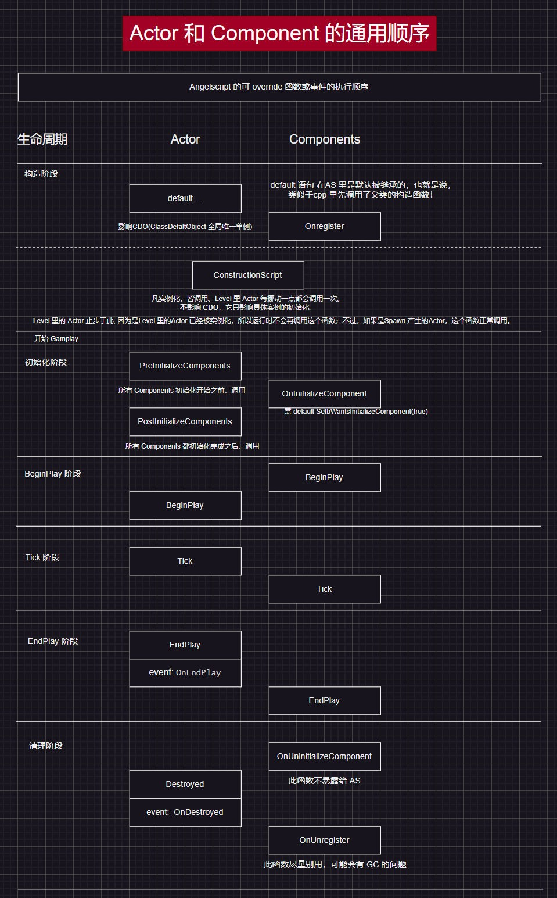
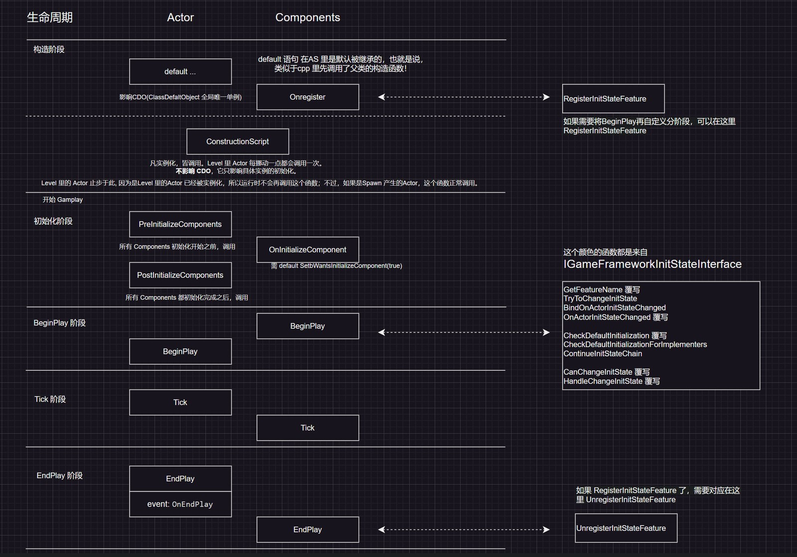

# UE_Angelscript 实践篇——自由的组件，实现功能模块化

如果要给一个 Actor 增加功能，常见的写法是在 Actor 里写，为了代码的复用，可以使用接口，或者也可以写在组件里。

接口的本质是继承，一般不能动态新增，只能在编译之前就定义好。
而组件就像是类的成员，可以动态生成与挂接，比较自由。

接口（UInterface) 是一套函数的集合。
而组件 (UActorComponent) 还可以拥有自己的成员。

当深入理解二者的使用差异时，对于 Actor 来说，接口除了可以保持轻量化之外（只有函数），其他功能都可以被组件涵盖了。从功能上来说，接口远小于组件。

不过对于 UObjct ，接口在引擎里还是拥有统治力的，毕竟 UActorComponent 只适用于 Actor 类型。（思考，需不需要给 UObject 做一种类似组件的东西？）

# Actor 与 Component

组件那么好用，以至于 AS 的官方团队直接禁用了 UInterface， 而且为组件做相当好的包装，一切都是为了易于使用。

声明组件、替换组件，写在标识符里就可以了。例如声明组件一个默认根组件只需要这么写，要是在 cpp，得写一大堆。另外替换父类的组件为自己的，也就一个标识符的事情。

```cpp
// 声明组件
UPROPERTY(DefaultComponent, RootComponent)
UStaticMeshComponent Mesh;

// 替换组件
UPROPERTY(OverrideComponent = CharMoveComp)
UMyCharacterMovementComponent DeeCharMoveComp;
```

不过，组件虽好，仍然会发现它暴露给 AS 的内容比较少。默认情况下，UActorComponent 只有几个可以覆写的函数：

```cpp
class UTestComp: UActorComponent
{
	UFUNCTION(BlueprintOverride)
	void BeginPlay()
	{
	}

	UFUNCTION(BlueprintOverride)
	void Tick(float DeltaSeconds)
	{
	}

	UFUNCTION(BlueprintOverride)
	void EndPlay(EEndPlayReason EndPlayReason)
	{
	}

	UFUNCTION(BlueprintOverride)
	void AsyncPhysicsTick(float DeltaSeconds, float SimSeconds)
	{
	}
}
```

对于简单的情况而言，这也勉强够用了。但是对于更复杂的情况，比如需要更多的初始化时机来合理规划初始化的顺序，比如需要动态挂载组件，比如需要更多的提前写好的胶水函数，那么这个组件就需要稍稍拓展了。

## Actor 与组件的一生

一图胜千言，以下是在 AS 里 Actor 与其组件的默认生命周期。

有些阶段是 AS 里的 AActor 与 UActorComponent 没有的，需要自行从 cpp 暴露出去。
这里给 Actor 加上了 PreInitializeComponents、PostInitializeComponents 两个阶段。
这里给组件加上了 Onregister 、OnInitializeComponent、OnUninitializeComponent、OnUnregister 四个阶段。

这些函数里，除了 OnUninitializeComponent 外，我都将其转发给了 AS ，方式是通过继承来进行的。在引擎和 Cpp 之间有一个中间层，这里类做了转发。至于为什么这么做，可参考本系列的《UE_Angelscript 认知篇——应用的项目结构参考》。

为什么总结了此图？因为 cpp 里的这些函数执行顺序与 AS 有些不一致，另外 ConstructionScript 是一个蓝图专用的内容，也存在于 AS 里，如果不将这些阶段弄清楚，AS 里写起代码来就不知道执行先后了。



**组件的初始化如还需更细致的控制？**

一般情况下，可以用委托来排执行顺序，可以确保先后。

如果复杂到了一定的程度，可以上 IGameFrameworkInitStateInterface 这个接口，其可以将 BeginPlay 的阶段进行自定义的区分，让各个组件之间可以互相监听对方的初始化进展，从而实现比委托更复杂的初始化控制流程。

这套流程比较经典的例子就是 Lyra 里 ULyraPawnExtensionComponent 与 ULyraHeroComponent 的初始化逻辑，有不少人写过相关的文章，可以搜索查看。

这里和原生的阶段融合，可以如下图所示。
需要在组件注册的时候，将组件自身注册给这个初始化辅助系统，然后组件 EndPlay 的时候，将组件自身从初始化辅助系统里注销。最关键的是 BeginPlay 阶段，可以划分为任意多的阶段，自定义阶段的名称，这里列举了一些可以覆写和调用的函数。要 AS 实现这些功能，需要将 IGameFrameworkInitStateInterface 的接口应用于 cpp 的父类，然后通过覆写和绑定等方式，将接口的函数暴露出来。



## 动态挂载组件

最简单的情况是，可以将 New 一个组件，然后作为 Actor 的成员。

如果一定要作为组件，不只是成员，还要动态挂载。可以考虑使用 GameFeature 的挂载方式。如果又需要，得学一下 GameFeature 的相关使用方式了。

这个动态挂载的功能实现跟 UGameFrameworkComponentManager 这个 UGameInstanceSubsystem 息息相关。

## 组件的更多胶水代码

引擎 ModularGameplay 模块里有 UGameFrameworkComponent ，GameFrameworkComponent  有四类，

- GameStateComponent
- PlayerStateComponent
- PawnComponent
- ControllerComponent

从这里继承，那么就可以省掉好多好多胶水代码了。（带来的一点问题是，原先给 UActorComponent 写的一些拓展代码，得都复制过来。）

另外，这些胶水代码有不少是模板函数，需要特化为某个类型来绑定使用。

## 小结

Actor 与组件是在 UE 里经常要用到的，自然是整得足够好用了。经过以上的处理，应该会更加好使的，如果不好使，那就不用了嘛。当然，如果还不需要其中一些复杂的东西，那么建议一定要先放一放，比如组件的初始化如还需更细致的控制？这不容易。

# UObject 的组件何在

Actor 有这么灵活的组件，明显是天选之子。作为 UObject 这么元老，提供了那么多基础的东西，然而，也因为它只提供基础的东西，就没有组件一说。

UObject 没有组件可用，在 AS 里也没有 UE 接口可用，怎么实现多个 UObject 共享一套方法呢？复制？一两个可以，N 个就不行了。

问了一些大佬，也没有提供这类方案，这里姑且写了一个方案，经过逻辑推演，可以实现简单版本的 UObject 组件系统。

设定目标：
这个 UObject 组件系统不能动 UObject 的源码；
不能强制继承于 UObject 的子类，否则就失去了泛用性；
写起来要方便，开销可控。

最终，实现下来，也就两个类的事情，一个是组件的基类，类似于 UActorComponent， 另外一个是 Subsystem ，用于管理组件与 Object 的映射。

## 组件的实现

最新更新：以下的部分内容有误，特别是关于 Outer 的理解，也许需要看这篇，UE 的 Outer 是什么意思（已更正，后附详细证明）

这里给出头文件，主要提供思路。

UObject 的组件的名称用 Part，与 Component 区分，免得 Actor 调用函数的时候相当尴尬。这里用到了 FObjectkey ，作为 Map 的键，比指针好用不少。

```cpp
// ObjectPart.h

/**
 * Don't use NewObject(...) to Create instance for it, * Use UObjectPartSubsystem::Get().AddPart(...) or UObject's mixin function .AddPart(...) */UCLASS(Abstract, Blueprintable)
class My_API UObjectPart : public UObject
{
    GENERATED_BODY()

public:
    // Called by UObjectPartSubsystem only
    void InitializePart(UObjectPartSubsystem* InSubsystem, UObject* InOwner);

    virtual void BeginDestroy() override;

    UFUNCTION(BlueprintCallable)
    UObject* GetOwnerObject() const;

    UFUNCTION(BlueprintCallable, meta=(DeterminesOutputType=ObjectType))
    UObject* GetOwnerObjectByType(const TSubclassOf<UObject> ObjectType) const;

    UFUNCTION(BlueprintCallable)
    UObjectPartSubsystem* GetObjectPartSubsystem() const;

protected:
    TWeakObjectPtr<UObjectPartSubsystem> Subsystem;
    // Use ObjectKey to be the key in the UObjectPartSubsystem's TMap
    FObjectKey OwnerObjectKey;
};
```

## 组件系统的实现

这里给出头文件，主要提供思路。

这个系统管理组件与其 Owner 的映射。Owner 就是组件的 Outer , Outer 如果被回收，那么组件也会被回收，当组件回收的时候，会触发这个管理系统的映射删除机制。

刚刚提到的 FObjectkey 作为键，就是为了防止使用其他 UE 指针时被归为 nullptr 的情况出现。什么？使用裸指针？可以是可以，但 UE 并不建议使用裸指针作为成员的一部分呢，因为如果哪里不小心访问了变为无效指针的裸指针，引擎就果断崩了。

但值得注意的是，此方案并没有考虑序列化、网络复制等问题，如有相关需求，需要进行相关处理。

```cpp
class My_API UObjectPartSubsystem : public UGameInstanceSubsystem
{
	GENERATED_BODY()

public:
	template <typename T, typename = typename TEnableIf<TIsDerivedFrom<
		          T, UObjectPart>::Value>::Type>
	T* AddPart(UObject* Owner, const TSubclassOf<T> PartClass);

	UFUNCTION(BlueprintCallable, meta=(DeterminesOutputType=PartClass),
		DisplayName="AddPart")
	UObjectPart* AddPart(UObject* Owner,
	                               const TSubclassOf<UObjectPart> PartClass);

	void RemovePart(const FObjectKey OwnerKey, UObjectPart* Part);

	UFUNCTION(BlueprintCallable)
	void BP_RemovePart(const UObject* Owner, UObjectPart* Part)
	{
		RemovePart(Owner, Part);
	};

	void RemovePartByClass(const FObjectKey OwnerKey,
	                            const TSubclassOf<UObjectPart>& PartClass);

	UFUNCTION(BlueprintCallable)
	void BP_RemovePartByClass(const UObject* Owner,
	                               const TSubclassOf<UObjectPart>& PartClass)
	{
		RemovePartByClass(Owner, PartClass);
	};

	// get the first component of the class
	UFUNCTION(BlueprintCallable)
	UObjectPart* GetPartByClass(UObject* Owner,
	                                      const TSubclassOf<UObjectPart>& PartClass);

	UFUNCTION(BlueprintCallable)
	TArray<UObjectPart*> GetPartTArrayByClass(UObject* Owner,
	                                                    const TSubclassOf<UObjectPart>&
	                                                    PartClass);

	UFUNCTION(BlueprintCallable)
	TArray<UObjectPart*> GetAllParts(UObject* Owner);

private:
	TMap<FObjectKey, TArray<TWeakObjectPtr<UObjectPart>>> PartsMap;
};

template <typename T, typename>
T* UObjectPartSubsystem::AddPart(UObject* Owner, const TSubclassOf<T> PartClass)
{
	// 以 Owner 作为Outer, 生命周期跟随它
	T* NewPart = NewObject<T>(Owner, PartClass);
	// 让 NewPart 持有 Owner 和本 Subsystem 的 TWeakObjectPtr
	NewPart->InitializePart(this, Owner);

	const FObjectKey OwnerKey(Owner);
	PartsMap.FindOrAdd(OwnerKey).Add(NewPart);
	return NewPart;
}
```

## Mixin

虽然经过上面的一通操作，实现了组件的管理系统，但是用起来还是不那么方便的，每次都要写 UObjectPartSubsystem::Get() ，用起来并不直接高效，也不符合调用组件的逻辑，所以用 Mixin 的黑科技将组件的相关函数都弄给 UObject。

以下是代码，直接在 AS 里写就好了。

```cpp
mixin UObjectPart AddPart(UObject Owner, const TSubclassOf<UObjectPart> PartClass)
{
	return UObjectPartSubsystem::Get().AddPart(Owner, PartClass);
}

mixin void RemovePart(UObject Owner, UObjectPart Part)
{
	UObjectPartSubsystem::Get().RemovePart(Owner, Part);
};

mixin UObjectPart GetPartByClass(UObject Owner, const TSubclassOf<UObjectPart>& PartClass)
{
	return UObjectPartSubsystem::Get().GetPartByClass(Owner, PartClass);
};

mixin TArray<UObjectPart> GetPartTArrayByClass(UObject Owner, const TSubclassOf<UObjectPart>& PartClass)
{
	return UObjectPartSubsystem::Get().GetPartTArrayByClass(Owner, PartClass);
};

mixin TArray<UObjectPart> GetAllParts(UObject Owner)
{
	return UObjectPartSubsystem::Get().GetAllParts(Owner);
};

mixin bool HasPartByClass(UObject Owner, const TSubclassOf<UObjectPart>& PartClass)
{
	auto Part = Owner.GetPartByClass(PartClass);
	return (Part == nullptr) ? false : true;
}
```

## 小结

经过以上的处理， UObject 就拥有了自己的一套组件系统。这个系统不需要太复杂，可以共享一些相同的方法和数据就好了。

# 总结

组件的出现，是为了功能的解耦。对于 Actor ，重量级的选手，UE 给打造了不错的组件系统，只是有不少内容还是 cpp 可以愉快使用，不过经过一些继承与绑定操作， AS 也能愉快地用起来了。对于 UObject，其实不需要那么复杂的系统，但因为 AS 里接口的缺失，共享功能成了问题，所以本文提供了一种思路，或有不足，望不吝赐教。

---
